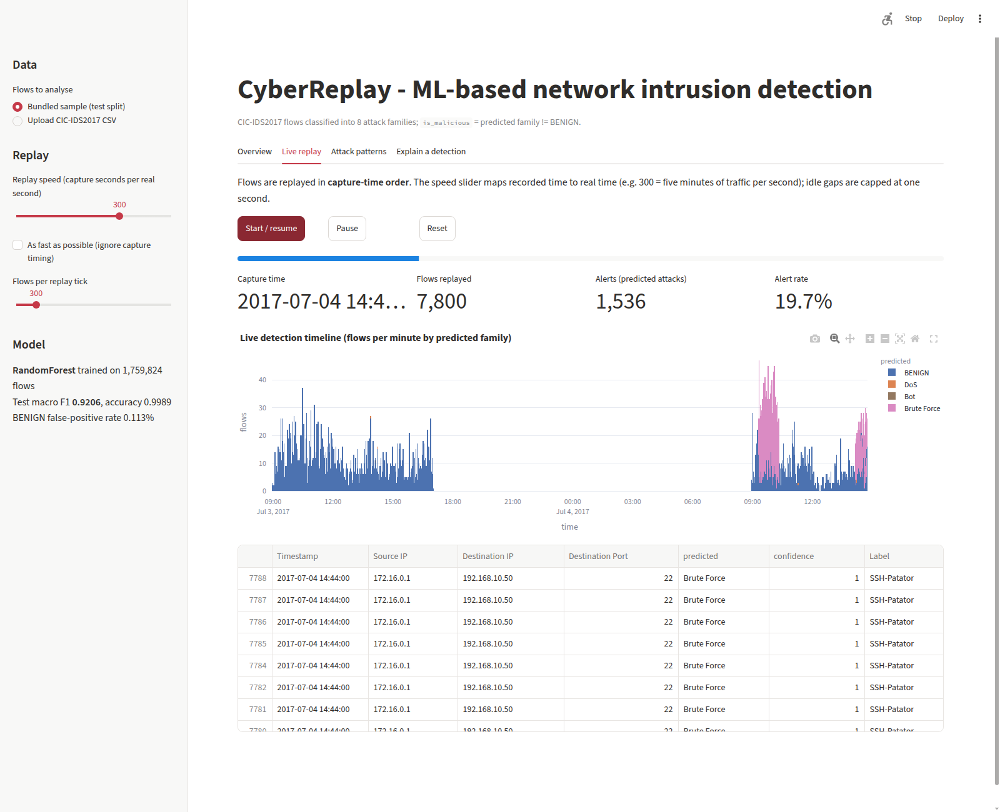

# CyberReplay

**Machine Learning-Based Network Intrusion Detection and Attack Analysis on CIC-IDS2017** (Track A).

CyberReplay classifies network flows from CIC-IDS2017 into 8 attack families (BENIGN, DoS, DDoS, PortScan, Bot,
Brute Force, Web Attack, Rare), derives a binary `is_malicious` flag from the prediction, compares Logistic
Regression, Decision Tree, Random Forest and XGBoost, explains detections with SHAP and replays the captured
traffic through a Streamlit dashboard with live predictions.

## Results (held-out test split, 439,956 flows)

| Model | Accuracy | Macro precision | Macro recall | Macro F1 | BENIGN false-positive rate | Train time (1.76 M flows) | Inference (440k flows) |
|---|---|---|---|---|---|---|---|
| Logistic Regression | 0.9828 | 0.6497 | 0.8804 | 0.7147 | 1.64% | 231 s | 0.30 s |
| Decision Tree | 0.9988 | 0.8781 | 0.9140 | 0.8950 | 0.10% | 32 s | 0.09 s |
| **Random Forest** (final) | 0.9989 | 0.9360 | 0.9329 | **0.9206** | 0.11% | 92 s | 0.50 s |
| XGBoost | 0.9990 | 0.9111 | 0.9296 | 0.9117 | 0.11% | 62 s | 1.39 s |

Random Forest is the final model: best macro F1 (95% bootstrap CI 0.864-0.947, ahead of XGBoost in 99% of paired
resamples), best minority-class recall (0.893), 0.11% BENIGN false alarms and ~1.1 µs per flow. The derived binary
`is_malicious` reaches F1 0.9965 (precision 0.9938, recall 0.9993). Full tables: `reports/results/`; discussion:
`reports/report.pdf`.



## Repository layout

| Path | Content |
|---|---|
| `src/cyberreplay/` | Python package: `config`, `data`, `clean`, `eda`, `features`, `models`, `tuning`, `evaluate`, `explain`, `replay`, `utils`, `pipeline` (CLI) |
| `notebooks/CyberReplay.ipynb` | Main deliverable - executed end to end, Colab-ready (outputs saved) |
| `app/streamlit_app.py` | Dashboard: overview, live replay, interactive attack patterns, SHAP explanation per detection |
| `reports/report.md`, `reports/report.pdf` | Final report (Markdown source and PDF: 5-page main report, then Appendix A with explained code excerpts) |
| `reports/notebook.pdf` | Executed notebook exported to PDF |
| `reports/figures/` | All plots (PNG) |
| `reports/results/` | All metric tables (CSV + Markdown), tuning results, best parameters |
| `models/best_model.joblib` | Best pipeline (feature selection + preprocessing + model), xz-compressed, with `best_model_metadata.json` |
| `data/sample/cicids2017_sample.csv.gz` | Stratified 29,999-flow sample of the **test split** (all 8 families) - dataset-sample deliverable and dashboard demo data |
| `scripts/` | `build_notebook.py` (generates the notebook), `build_pdfs.py` (report + notebook PDFs) |
| `tests/` | Unit tests and a headless dashboard test (`streamlit.testing.v1.AppTest`) |
| `PROGRESS.md`, `DECISIONS.md` | Build checklist and the log of every design decision |

## Dataset

* **CIC-IDS2017**, Canadian Institute for Cybersecurity, University of New Brunswick -
  official page: <https://www.unb.ca/cic/datasets/ids-2017.html>.
* Files used: `GeneratedLabelledFlows.zip` -> `TrafficLabelling/*.pcap_ISCX.csv` (8 day files, 2,830,743 labelled
  flows, 84 columns including `Timestamp`, needed for the replay).
* **Exact download used:** <https://huggingface.co/datasets/bencorn/CICIDS2017/resolve/main/csvs/GeneratedLabelledFlows.zip>
  (Hugging Face mirror of the official archive, SHA-256 `7bdbef286f8893f31c6db12105fa097fa5c2dcc6733179037a08129d150ea27a`,
  verified by `data.download_dataset`). The official server (`cicresearch.ca/CICDataset/CIC-IDS-2017/`) now redirects
  to a registration form, so the unattended build could not use it; you can download the same zip there manually.
* If only the `MachineLearningCSV` variant is available (no Flow ID / IP / Timestamp columns), the loader still works:
  the replay order is rebuilt from the capture-day order plus the row order inside each file, approximate timestamps
  are spread over each file's capture window, and the feature selection is recomputed because that variant has no
  `Protocol` column.
* Raw data is never committed (`data/raw/` is gitignored).

**Citation.** I. Sharafaldin, A. H. Lashkari and A. A. Ghorbani, "Toward Generating a New Intrusion Detection Dataset
and Intrusion Traffic Characterization", *Proc. 4th International Conference on Information Systems Security and
Privacy (ICISSP)*, Portugal, 2018, pp. 108-116.

## Run locally

```bash
python3 -m venv .venv && source .venv/bin/activate
pip install -r requirements.txt
pip install -e .                       # optional; otherwise use PYTHONPATH=src

# Full pipeline: download (if missing) -> EDA -> cleaning -> features -> CV -> tuning -> final fit
# -> evaluation -> best model -> SHAP -> replay. Writes reports/figures, reports/results and models/.
PYTHONPATH=src python -m cyberreplay.pipeline --download
#   --data-dir PATH   use an existing copy of the CSVs (searched recursively)
#   --force           recompute cached tuning results and fitted models
#   --quick           2-3 minute smoke test (not for reported results)

streamlit run app/streamlit_app.py     # dashboard on http://localhost:8501
pytest tests                           # unit tests + headless dashboard test

python scripts/build_notebook.py       # regenerate the notebook from its source
jupyter nbconvert --to notebook --execute --inplace notebooks/CyberReplay.ipynb --ExecutePreprocessor.timeout=-1
python scripts/build_pdfs.py           # reports/report.pdf + reports/notebook.pdf (needs Chrome/Chromium)
```

A full run with `--force` took 42 minutes on 8 CPUs / 47 GB RAM (no GPU). Without `--force`, the committed
tuning results in `reports/results/best_params_*.json` are reused and only the final fits run (a few minutes).

**Regenerating the model.** `models/best_model.joblib` is committed (it is small). If it is missing, the one
command `PYTHONPATH=src python -m cyberreplay.pipeline --download` recreates it (plus its metadata).

## Run in Google Colab (virtual lab)

1. Open the notebook directly in Colab:
   <https://colab.research.google.com/github/Shreyansh124/cyberreplay/blob/main/notebooks/CyberReplay.ipynb>
   (or File -> Open notebook -> GitHub tab -> `Shreyansh124/cyberreplay`).
2. Run all cells. The first cell runs `git clone -b BRANCH https://github.com/Shreyansh124/cyberreplay.git`
   (`BRANCH = "main"` by default) and installs `requirements.txt`; if NumPy/pandas get upgraded it restarts the
   runtime once - just run all cells again.
3. Data: set `DATA_SOURCE = "drive"` and `DRIVE_DATA_DIR` to the Drive folder that holds your CIC-IDS2017 CSVs
   (sub-folders are searched), or `DATA_SOURCE = "download"` to fetch the dataset automatically.
4. `FORCE_RECOMPUTE = False` reuses the committed CV/tuning results; the final fits on 1.76 M flows still run
   (a High-RAM runtime is recommended). `FINAL_FIT_ROWS = 500_000` gives a faster, approximate run.

## Design decisions (summary - see `DECISIONS.md`)

* Duplicates removed before the split; stratified 80/20 split; identifiers (Flow ID, IPs, ports, Timestamp)
  never used as features.
* Imputation / outlier capping / scaling fitted inside sklearn Pipelines on training data only.
* Feature selection (variance -> correlation -> importance) on the training split only: 77 -> 37 features.
* Class-weighted models (no SMOTE); weighting strength (`balanced` vs `sqrt`) tuned with RandomizedSearchCV
  (`scoring="f1_macro"`) on a 500k minority-preserving training sample; final fit on the full training split.
* StratifiedKFold on training data only. GroupKFold by capture day is infeasible because every attack type occurs on
  a single day.

## References

1. I. Sharafaldin, A. H. Lashkari, A. A. Ghorbani, "Toward Generating a New Intrusion Detection Dataset and Intrusion
   Traffic Characterization", ICISSP 2018.
2. F. Pedregosa et al., "Scikit-learn: Machine Learning in Python", JMLR 12, 2011.
3. T. Chen, C. Guestrin, "XGBoost: A Scalable Tree Boosting System", KDD 2016.
4. S. M. Lundberg, S.-I. Lee, "A Unified Approach to Interpreting Model Predictions", NeurIPS 2017; S. M. Lundberg et
   al., "From local explanations to global understanding with explainable AI for trees", Nature Machine Intelligence 2020.
5. A. H. Lashkari et al., CICFlowMeter, <https://github.com/ahlashkari/CICFlowMeter>.
