# CyberReplay: Machine Learning-Based Network Intrusion Detection and Attack Analysis

<p class="subtitle">Track A (library-based ML): multi-class intrusion detection on CIC-IDS2017 with scikit-learn and XGBoost. The code is a
modular Python package with an executed Colab notebook and a Streamlit traffic-replay dashboard.</p>

<div class="title-block">
<span style="white-space:nowrap"><b>Shreyansh Krishna</b> (2026CS05055)</span> &nbsp;·&nbsp; <span style="white-space:nowrap"><b>Aamir Lanker</b> (2026CS05054)</span> &nbsp;·&nbsp; <span style="white-space:nowrap"><b>Harshith G. D</b> (2026CS05053)</span> &nbsp;·&nbsp; <span style="white-space:nowrap"><b>Anil Pandey</b> (2026CS05031)</span><br>
Course: Machine Learning · Track A (library-based ML)
</div>

<div style="border:1px solid #888; background:#f4f4f4; padding:4pt 7pt; margin:2pt 0 6pt 0;" markdown="1">
**Summary of results.** We tuned and compared four models on 439,956 held-out test flows. **Random Forest is our final
model.** It has the best macro F1 (0.921, against 0.912 for XGBoost, 0.895 for Decision Tree and 0.715 for Logistic
Regression), the best minority-class recall (0.893), accuracy 0.9989 and a 0.11% BENIGN false-alarm rate, and it
predicts in about 1.1 µs per flow, 2.8× faster than XGBoost. As a malicious-versus-benign detector it reaches F1 0.997
(precision 0.9938, recall 0.9993). Its balanced accuracy is 0.933 and its one-vs-rest ROC-AUC 0.972; XGBoost has the
higher ROC-AUC (0.992) because it ranks the nine Rare test flows better.
</div>

## 1. Problem definition and motivation

An intrusion detection system watches network traffic and raises an alert when a connection looks like an attack.
Naming the attack type helps analysts sort alerts and respond correctly, because a flood, a password-guessing attempt
and a botnet each need different action. Our models read statistics of each flow (one connection between two
computers) and predict one of eight families: BENIGN, DoS, DDoS, PortScan, Bot, Brute Force, Web Attack or Rare. From
this prediction we set a binary `is_malicious` flag, which is 1 for every family except BENIGN. Most flows are benign
and some attacks are rare, so accuracy looks high even for a useless model. Our main metric is therefore
**macro F1**, which weights every family equally.

## 2. Dataset description and source

**Generation and features.** CIC-IDS2017 [1] was recorded by the Canadian Institute for Cybersecurity (University of
New Brunswick, UNB) over five working days, 3-7 July 2017, on a lab network of 25 users while scripted attacks ran on a
fixed schedule. The CICFlowMeter tool [6] turned the packet captures into 2,830,743 bidirectional flows with 80+
summary variables (durations, packet counts and sizes, inter-arrival times, TCP flags and window sizes) across 15
labels. We load the *GeneratedLabelledFlows / TrafficLabelling* CSVs, which also keep Flow ID, IPs, ports and
Timestamp. UNB publishes the dataset at <https://www.unb.ca/cic/datasets/ids-2017.html> but gates downloads behind a
registration form, so our script fetches the identical `csvs/GeneratedLabelledFlows.zip` from a Hugging Face mirror,
<https://huggingface.co/datasets/bencorn/CICIDS2017>, and verifies its SHA-256 hash. Our project ships a stratified
29,999-flow subset under `data/sample/`.

**Classes and split.** We merge the 15 labels into eight families (Table 1): Hulk, GoldenEye, slowloris and
Slowhttptest become **DoS**, FTP-/SSH-Patator **Brute Force**, the three web attacks **Web Attack**, and Infiltration
(36 flows) plus Heartbleed (11) **Rare**, while DDoS, PortScan and Bot stay as they are. After de-duplication
(Section 4) 2,199,780 flows remain. A stratified 80/20 split with seed 42 gives **1,759,824 training and 439,956 test
flows**, and every family keeps its share in both parts; even Rare has 38 training and 9 test flows (Fig 1).

<div class="keep" markdown="1">
<div class="left tight" markdown="1">

| Class | Raw labels | Meaning | Count | After de-dup. | Train | Test |
|:---|:---|:---|---:|---:|---:|---:|
| BENIGN | BENIGN | normal traffic of the lab users (web, e-mail, FTP, SSH) | 2,273,097 | 1,863,290 | 1,490,632 | 372,658 |
| DoS | DoS Hulk, GoldenEye, slowloris, Slowhttptest | one host floods or starves the web server | 252,661 | 193,733 | 154,986 | 38,747 |
| DDoS | DDoS | many hosts flood the web server (LOIC) | 128,027 | 128,016 | 102,413 | 25,603 |
| PortScan | PortScan | Nmap probes that look for open ports | 158,930 | 1,958 | 1,566 | 392 |
| Bot | Bot | Ares botnet hosts talking to their C&C server | 1,966 | 1,441 | 1,153 | 288 |
| Brute Force | FTP-Patator, SSH-Patator | password guessing on FTP and SSH | 13,835 | 9,152 | 7,322 | 1,830 |
| Web Attack | Web Attack - Brute Force, XSS, Sql Injection | login guessing, XSS and SQL injection on a web app | 2,180 | 2,143 | 1,714 | 429 |
| Rare | Infiltration, Heartbleed | internal infiltration and the Heartbleed memory leak | 47 | 47 | 38 | 9 |
| **Total** | 15 labels | | 2,830,743 | 2,199,780 | 1,759,824 | 439,956 |

</div>
<p class="cap"><b>Table 1.</b> The eight target families. Count is the raw number of flows; the last three columns are after de-duplication.</p>
</div>

<div class="figure">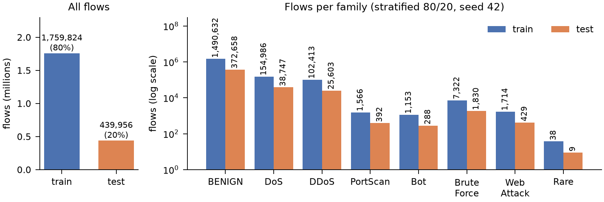
<p class="cap"><b>Fig 1.</b> Train/test split after de-duplication: total flows in each part (left) and flows per family in each part on a log scale, with counts on the bars (right).</p></div>

<div class="keep" markdown="1">
<div class="tight" markdown="1">

| Timestamp | Raw `Label` | `family` | `is_malicious` | Flow Duration (µs) | Total Fwd Packets | Total Length of Fwd Packets (B) |
|:---|:---|:---|---:|---:|---:|---:|
| 2017-07-03 08:57:05 | BENIGN | BENIGN | 0 | 149 | 2 | 328 |
| 2017-07-04 14:09:00 | SSH-Patator | Brute Force | 1 | 12,497,639 | 22 | 2,008 |
| 2017-07-05 09:48:00 | DoS slowloris | DoS | 1 | 508,471 | 4 | 231 |
| 2017-07-05 15:14:00 | Heartbleed | Rare | 1 | 119,262,216 | 2,792 | 13,712 |
| 2017-07-07 13:05:00 | PortScan | PortScan | 1 | 52 | 1 | 0 |

</div>
<p class="cap"><b>Table 2.</b> Five sample flows: the raw label, the family and binary target we derive from it, and three flow statistics.</p>
</div>

**Source and justification.** CIC-IDS2017 is a standard benchmark for intrusion detection, and its source paper [1]
documents how it was generated. It is far from the small, clean teaching datasets that the assignment asks us to
avoid: it has 2.8 million rows and 80+ numeric features from real protocols, extreme class imbalance (BENIGN:Rare ≈
48,000:1), documented label noise [2] and timestamps that let us replay the traffic in order.

## 3. Exploratory data analysis

<div class="side" markdown="1">
<div class="figcol"><p class="cap"><b>Fig 2.</b> Flows per raw label and capture file: each attack type appears on a single capture day. The other EDA plots are Fig 9-13 in the appendix.</p></div>
<div class="textcol" markdown="1">

**Observations.** (i) **Imbalance.** BENIGN makes up 80.3% of flows, while Rare holds 0.002% and Bot 0.069%
(BENIGN:Rare ≈ 48,000:1, Fig 9). Predicting BENIGN everywhere already scores 80% accuracy, so plain accuracy misleads
us and we apply class weighting. (ii) **Schedule.** Attacks hit in brief, heavy bursts on one day each (Fig 2 and
Fig 10), with DoS Hulk peaking at about 70k flows per 5 minutes. Day-based GroupKFold therefore fails, because holding
out any day removes its attack families from training completely. (iii) **Data quality.** Zero-duration flows yield
4,376 infinite rates and 1,358 missing values. We also found **630,963 exact duplicates (22.3%)** and 3,545 invalid
negatives; among PortScan rows, 98.8% repeat identical one- or two-packet probes (Fig 11). (iv) **Behaviour.** DoS
connections run long (median about 100 s) with heavy forward payloads, whereas DDoS sends tiny uniform packets
(Fig 12). PortScan and Web Attack mostly carry no payload, while Rare connections are both bulky and prolonged.
(v) **Extremes.** Heavy-tailed variables span 6-8 orders of magnitude, and 48.9% of Rare rows exceed the overall
99.9th percentile, so extreme values signal the rarest attacks and we do not delete them. (vi) **Redundancy.** 50
column pairs have |r| > 0.95, including 9 identical copies such as `Subflow Fwd Bytes` = `Total Length of Fwd
Packets`; they form the dark blocks of the correlation heatmap (Fig 13).

</div>
</div>

## 4. Data cleaning, preprocessing and feature engineering

**Cleaning.** We normalised the labels (fixing the cp1252 en dash), mapped them to families, replaced ±inf with NaN,
and clipped invalid negatives to 0 while keeping the `-1` "no TCP window" flag in `Init_Win_bytes_*`. We then
deduplicated rows on the features plus the target family, leaving **2,199,780 flows**, and kept the 622 rows whose
features recur under another family. None of these steps learns a statistic from the data, so running them before
the split cannot leak test information, and removing duplicates first means no flow can sit in both train and test.

**Encoding.** The eight families become integer codes 0-7 with BENIGN = 0, and `is_malicious` is derived as
prediction ≠ BENIGN. Flow ID, IPs, source/destination ports and Timestamp are never used as features, because they
identify hosts and capture time rather than describe flow behaviour.

**Scaling:** Every model runs column selection and median imputation inside a scikit-learn [3] `Pipeline` that is
fitted on training rows only, so CV folds stay leak-free. Logistic Regression adds training-set 99.9th-percentile
capping, a signed `log1p` transform and `StandardScaler`. Trees use uncapped inputs so extreme Rare rows stay
separable, and we never drop attack rows as outliers.

**Feature engineering.** On training data alone, we dropped 8 constant columns, used a greedy |r| > 0.95 filter to
drop 25 redundant columns, and pruned 7 more beyond 99% cumulative importance of a class-weighted Random Forest,
which reduces **77 candidates to 37 features**. For the imbalance we use class weights without SMOTE: inside `fit`,
each estimator converts `class_weighting` into sample weights using `balanced` = n/(k·n<sub>c</sub>) or its square
root, so the weights come from the rows of the current training fold.

## 5. Model building, cross-validation and tuning

**Split.** The test split stays untouched until Section 6. We run CV and hyperparameter search on a 500k-row
*training* subset that keeps every minority-family row (all 38 Rare rows) and thins BENIGN, DoS and DDoS in
proportion. All folds are shuffled StratifiedKFold with seed 42; GroupKFold by capture day is not possible, as
observation (ii) shows.

**Algorithms.** We evaluate three tree methods, **Decision Tree** (CART), **Random Forest** [7] and **XGBoost**
(hist) [4], alongside a multinomial **Logistic Regression** and a majority-class baseline (`DummyClassifier`,
most frequent), which always predicts BENIGN. Each model is scored with default hyperparameters in 5-fold CV, tuned
with `RandomizedSearchCV` (3-fold, `scoring="f1_macro"`) and refitted with its best hyperparameters on the **full**
training split. Balanced accuracy is the mean of the per-class recalls, so for a multi-class problem it is the same
number as macro recall.

<div class="keep" markdown="1">
<div class="tight hp" markdown="1">

| Model | CV macro-F1 (mean ± std) | CV bal. acc. | Train macro-F1 | CV macro-F1 after tuning | Best hyperparameters (RandomizedSearchCV, `f1_macro`) |
|---|---|---|---|---|---|
| Dummy (most frequent) | 0.114 ± 0.000 | 0.125 | 0.115 | - | no hyperparameters; always predicts BENIGN |
| LogisticRegression | 0.534 ± 0.002 | 0.954 | 0.723 | 0.790 | C = 10.1, square-root class weights (10 candidates) |
| DecisionTree | 0.945 ± 0.018 | 0.937 | 0.979 | 0.949 | entropy, no depth limit, min_samples_leaf 2, max_features 0.8 (30) |
| RandomForest | 0.954 ± 0.012 | 0.954 | 0.964 | 0.963 | 150 trees, max_depth 20, max_features 0.5, entropy (20) |
| XGBoost | 0.960 ± 0.007 | 0.969 | 0.967 | 0.966 | 300 rounds, depth 6, learning rate 0.24, subsample 0.77, colsample 0.68 (20) |

</div>
<p class="cap"><b>Table 3.</b> CV on the tuning sample: 5-fold with default hyperparameters, then the tuned 3-fold score (all candidates in Fig 14). Train macro-F1 is the final model, fitted on all 1,759,824 training flows, scored on those same flows.</p>
</div>

<div class="figure">
<p class="cap"><b>Fig 3.</b> Macro F1 per StratifiedKFold fold (default hyperparameters); legend: fold mean ± std; the y-axis is broken between 0.54 and 0.92.</p></div>

Across folds (Fig 3), tree macro F1 varies by just ±0.007-0.018 and per-fold accuracy never drops below 0.998.
Fully balanced Logistic Regression gets 0.95 macro recall but 0.47 macro precision, so its balanced accuracy is high
while its macro F1 is low; relaxing the weight strength raised its macro F1 by +0.26, while the trees kept full weights.

## 6. Evaluation: under/overfitting diagnosis and test-set metrics

### 6.1 Under- and overfitting

We carve a stratified 20% validation slice from the training split only (seed 42; 1,407,859 fitting and 351,965
validation flows; the test split is not used), fit each tuned model on the other rows and compare macro F1 on both
parts (Table 4). Our rule: training macro F1 below 0.90 means the model cannot fit its own data (**underfit**, high
bias); otherwise a gap above 0.05 means **overfit** (high variance), 0.02-0.05 a **slight overfit**, and a smaller gap a
**good fit**.

<div class="keep" markdown="1">
<div class="tight" markdown="1">

| Model | Train F1 | Validation F1 | Gap | Diagnosis | Model | Train F1 | Validation F1 | Gap | Diagnosis |
|---|---|---|---|---|---|---|---|---|---|
| Dummy | 0.115 | 0.115 | 0.000 | underfit (high bias) | RandomForest | 0.965 | 0.948 | 0.017 | good fit |
| LogisticRegression | 0.720 | 0.716 | 0.004 | underfit (high bias) | XGBoost | 0.971 | 0.944 | 0.026 | slight overfit |
| DecisionTree | 0.973 | 0.918 | 0.055 | overfit (high variance) | | | | | |

</div>
<p class="cap"><b>Table 4.</b> Macro F1 on the fitting rows and on the validation slice carved from the training split.</p>
</div>

The validation ranking (Random Forest 0.948, XGBoost 0.944, Decision Tree 0.918, Logistic Regression 0.716) matches
the test ranking in Table 5 and so agrees with our choice of Random Forest. The single tree loses 0.055 on new rows,
while averaging 150 depth-limited trees cuts the gap to 0.017; Logistic Regression has almost no gap but a low score.

<div class="figure"><div class="row">
<div class="col">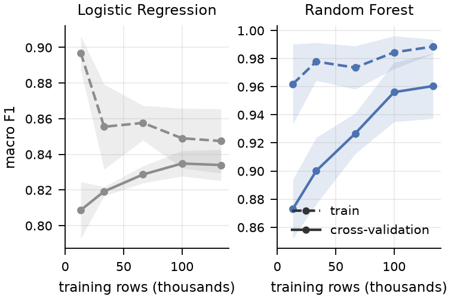<p class="cap"><b>Fig 4.</b> Learning curves: train and 3-fold CV macro F1 against training rows (mean ± std over folds).</p></div>
<div class="col">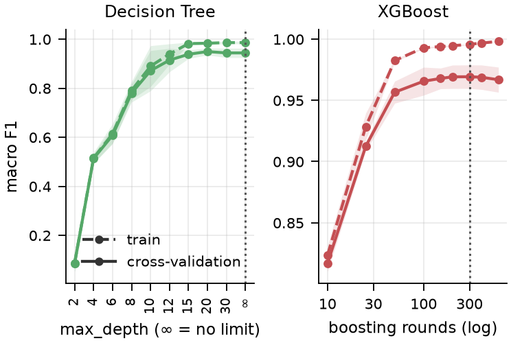<p class="cap"><b>Fig 5.</b> Validation curves: Decision Tree depth and XGBoost boosting rounds; dotted lines mark the tuned values.</p></div>
</div></div>

**Reading Fig 4.** Both curves use a 200k-row stratified training subsample that keeps every minority row and 3-fold
StratifiedKFold, so each fit sees 13,333 to 133,333 rows. For Logistic Regression the training and CV scores meet at about 0.84 and stay flat, the mark of high bias: more data
will not fix a linear boundary. For Random Forest the CV score keeps rising, from 0.873 to 0.960, and the gap to the
training score shrinks from 0.089 to 0.028, so its remaining error is mostly variance that more data reduces.

**Reading Fig 5.** The Decision Tree moves from underfitting to overfitting as `max_depth` grows. Up to depth 12 the
training and CV curves rise together (from 0.086 at depth 2), but beyond depth 15 the training score reaches
0.98-0.99 while CV levels off at 0.94-0.95, so the gap widens to about 0.04; depth 20 would score slightly above our
unlimited depth (0.950 against 0.944), a difference within one fold standard deviation. For XGBoost the CV score peaks
at 0.969 around 200-300 rounds and slips to 0.967 at 600 rounds while the training score climbs to 0.998, so the tuned
300 rounds sit where extra trees start to add variance.

### 6.2 Test-set metrics

<div class="keep" markdown="1">
<div class="tight" markdown="1">

| Model | Accuracy | Bal. acc. | Precision (macro) | Recall (macro) | **F1 (macro)** | 95% CI (F1) | ROC-AUC (OvR) | Minority recall | BENIGN FPR | Train time | Inference (440k flows) |
|---|---|---|---|---|---|---|---|---|---|---|---|
| Dummy (most frequent) | 0.8470 | 0.1250 | 0.1059 | 0.1250 | 0.1146 | - | 0.5000 | 0.000 | 0.00% | - | - |
| LogisticRegression | 0.9828 | 0.8804 | 0.6497 | 0.8804 | 0.7147 | 0.705-0.726 | 0.9791 | 0.819 | 1.64% | 231 s | 0.30 s |
| DecisionTree | 0.9988 | 0.9140 | 0.8781 | 0.9140 | 0.8950 | 0.848-0.923 | 0.9571 | 0.863 | 0.10% | 32 s | 0.09 s |
| **RandomForest** | 0.9989 | **0.9329** | **0.9360** | **0.9329** | **0.9206** | 0.864-0.947 | 0.9716 | **0.893** | 0.11% | 92 s | 0.50 s |
| XGBoost | **0.9990** | 0.9296 | 0.9111 | 0.9296 | 0.9117 | 0.857-0.943 | **0.9918** | 0.888 | 0.11% | 62 s | 1.39 s |

</div>
<p class="cap"><b>Table 5.</b> Results on the 439,956 held-out test flows; the CI comes from a paired bootstrap over 300 resamples. All metrics side by side in Fig 16.</p>
</div>

Balanced accuracy repeats macro recall, as expected for a multi-class problem, and the Dummy shows why accuracy
misleads: always answering BENIGN scores 0.847 accuracy but 0.115 macro F1. For the derived binary `is_malicious`,
tree models reach F1 of 0.996-0.997 (Random Forest: 0.9938 precision, 0.9993 recall) versus 0.947 for Logistic
Regression, and Random Forest beats XGBoost in 99% of the bootstrap draws. On one-vs-rest ROC-AUC [14] the order
changes: XGBoost leads with 0.992, ahead of Logistic Regression (0.979), Random Forest (0.972) and Decision Tree
(0.957). AUC measures how well probabilities rank flows, and Random Forest gives four of the nine Rare test flows (all
Infiltration) the same zero Rare probability as almost every other flow, capping its Rare AUC at 0.78; its other
families reach at least 0.997. The Rare curve, built from only nine positives, is noisy and moves in steps of 1/9.

<div class="figure">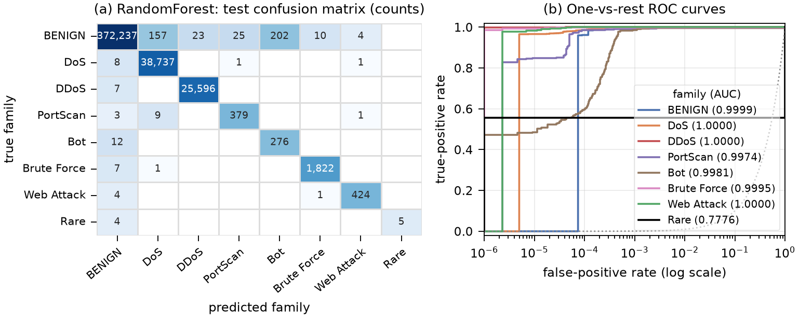
<p class="cap"><b>Fig 6.</b> Final model (Random Forest) on the test split: (a) confusion matrix with raw counts (log colour scale; empty cells are zero) and (b) one-vs-rest ROC curve per family with its AUC, on a logarithmic false-positive axis. The confusion matrices of all four models are in Fig 15.</p></div>

<div class="side" markdown="1">
<div class="figcol">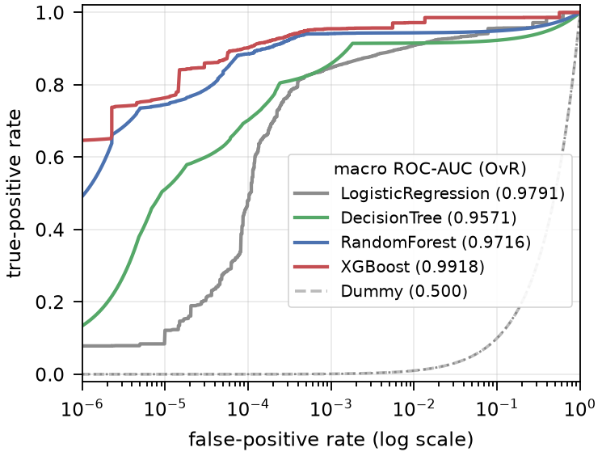<p class="cap"><b>Fig 7.</b> Macro-average one-vs-rest ROC curve of each model (per-family curves averaged on a common false-positive grid); the Dummy follows the chance line. Per-class F1 of all models is in Fig 17.</p></div>
<div class="textcol" markdown="1">

| Family | Precision | Recall | F1 | ROC-AUC | Test flows |
|---|---|---|---|---|---|
| BENIGN | 0.9999 | 0.9989 | 0.9994 | 0.9999 | 372,658 |
| DoS | 0.9957 | 0.9997 | 0.9977 | 1.0000 | 38,747 |
| DDoS | 0.9991 | 0.9997 | 0.9994 | 1.0000 | 25,603 |
| PortScan | 0.9358 | 0.9668 | 0.9511 | 0.9974 | 392 |
| Bot | 0.5774 | 0.9583 | 0.7206 | 0.9981 | 288 |
| Brute Force | 0.9940 | 0.9956 | 0.9948 | 0.9995 | 1,830 |
| Web Attack | 0.9860 | 0.9883 | 0.9872 | 1.0000 | 429 |
| Rare | 1.0000 | 0.5556 | 0.7143 | 0.7776 | 9 |

<p class="cap"><b>Table 6.</b> Per-class test metrics of the final Random Forest.</p>

Four classes (BENIGN, DoS, DDoS and Brute Force) are effectively solved at F1 ≥ 0.995, and attacks are rarely
confused with each other. Nearly every error involves BENIGN: Random Forest flags 202 benign flows as Bot plus 157 as
DoS, and misses 12 of 288 Bot flows along with 4 out of 9 Rare rows (each an Infiltration flow). Holdout macro F1
trails CV (≈0.96) because the real benign share pulls Bot precision down to 0.58 and Rare has just 9 test flows (each
miss costs about 0.1 class F1). Excluding Rare lifts the tree models to 0.947-0.950.

</div>
</div>

**Recall by original attack label.** To see which tools inside a family the Random Forest misses, we split its test
recall over the 15 raw labels of the same held-out split (Table 7). All four DoS tools, DDoS, FTP-Patator and
Heartbleed reach at least 0.998, so merging the DoS variants into one family hides no weak tool. The weakest sub-types
are Infiltration (3 of 7 detected, the other 4 called BENIGN), Bot (12 of 288 missed as BENIGN), PortScan (9 of its 13
misses predicted as DoS) and Web Attack - XSS (115 of 118). The 5 SQL Injection flows are all caught, though so few
flows say little.

<div class="keep" markdown="1">
<div class="tight" markdown="1">

| Raw label | Test flows | Recall | Raw label | Test flows | Recall | Raw label | Test flows | Recall |
|:---|---:|---:|:---|---:|---:|:---|---:|---:|
| BENIGN | 372,658 | 0.9989 | DDoS | 25,603 | 0.9997 | Web Attack - Brute Force | 306 | 0.9935 |
| DoS Hulk | 34,618 | 0.9999 | PortScan | 392 | 0.9668 | Web Attack - XSS | 118 | 0.9746 |
| DoS GoldenEye | 2,066 | 0.9990 | Bot | 288 | 0.9583 | Web Attack - Sql Injection | 5 | 1.0000 |
| DoS slowloris | 1,019 | 0.9990 | FTP-Patator | 1,194 | 0.9983 | Infiltration | 7 | 0.4286 |
| DoS Slowhttptest | 1,044 | 0.9981 | SSH-Patator | 636 | 0.9906 | Heartbleed | 2 | 1.0000 |

</div>
<p class="cap"><b>Table 7.</b> Random Forest test recall per raw label (flows predicted as the label's family); the full table, with the most common wrong family, is <code>reports/results/per_raw_label_recall.csv</code>.</p>
</div>

### 6.3 Feature importance and attack patterns

<div class="side" markdown="1">
<div class="figcol">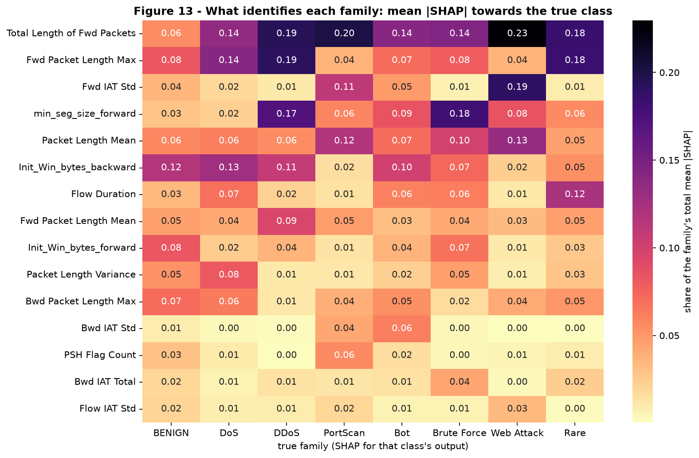<p class="cap"><b>Fig 8.</b> Feature importance per family: SHAP (TreeExplainer, 1,759 stratified test flows) as each feature's share of a family's mean |SHAP| towards its own class. Native importances of all models: Fig 18.</p></div>
<div class="textcol" markdown="1">

Both tree importances (Fig 18) and SHAP [5] (Fig 8; effect directions in Fig 19) highlight forward timing spread
(`Fwd IAT Std`), TCP handshake settings (`min_seg_size_forward`, `Init_Win_bytes_*`) and payload size (`Total Length
of Fwd Packets`, `Fwd Packet Length Max`, `Packet Length Mean`). **DoS** connections carry oversized forward packets
(median max 343 B vs 44 B benign) and run long as slow-rate attacks hold sockets open. **DDoS** flows send tiny,
uniform forward packets totalling 26 B per flow. **PortScan** probes last microseconds, exchange 1-2 packets at steady
intervals and carry no payload. **Web Attack** forward payload is nearly absent, yet forward packet spacing is
irregular (`Fwd IAT Std` median 3.8 s vs 0). **Brute Force** and **Bot** are exposed by the TCP stack of their tools
(a constant `min_seg_size_forward` and the C&C server's TCP window). **Rare**: Heartbleed transfers ~12 kB over
~100 s, while the benign median duration is 59 ms (Fig 20).

</div>
</div>

## 7. Justification of the final model, discussion, limitations and future work

**Justification.** We pick Random Forest for its top test macro F1 (0.921), macro F1 without Rare (0.950) and
minority recall (0.893 across PortScan, Bot, Brute Force, Web Attack and Rare). Its 0.11% BENIGN false-positive rate
produces ≈420 false alarms across 373k benign records, matching XGBoost and cutting Logistic Regression's false alarms
by 15×. It is the only good fit in Table 4 with the best validation macro F1, so the validation slice agrees with the
test-based choice. Training takes 1.5 min, prediction runs at ~1.1 µs per flow (2.8× faster than XGBoost) and the
saved pipeline occupies roughly 5.5 MB. Two views favour XGBoost, and we report them openly: it led cross-validation
on the tuning sample by 0.003-0.006 (Table 3) and has the higher ROC-AUC (0.992 against 0.972). XGBoost is therefore a
tight runner-up, while Decision Tree suits tasks needing speed and simple rules.

**Discussion.** Our class-weighted Random Forest uses 37 flow features to separate eight families at 0.921 test macro
F1 (0.950 without Rare) and catches 99.9% of malicious traffic with 0.11% false alarms. The diagnostics explain the
ranking: Logistic Regression is limited by bias rather than by data (Fig 4), a single deep tree overfits, and
averaging many trees removes most of that variance, with boosting in between.

**Limitations.** (1) *Optimistic evaluation.* Stratified random splitting puts flows from the same attack burst into
both train and test, and single-day schedules rule out day-level GroupKFold, so our metrics reflect detection of seen
attacks on the same testbed rather than generalisation to new tools or networks. (2) *Label quality.* Audits document
labelling and flow-building defects in CIC-IDS2017 [2]. Among the 202 BENIGN-to-Bot "false alarms", 158 contact
205.174.165.73:8080, the same Ares C&C endpoint seen across all labelled Bot flows, suggesting unlabelled bot
activity. (3) *Tiny classes and fingerprints.* Only 47 Rare flows exist (9 in test), so its F1 and AUC are uncertain
and Infiltration recall is low (3/7); TCP-stack features also fingerprint the attack tools. (4) *Offline features.*
CICFlowMeter emits features only after flows close, so the replay is near-real-time. (5) *Curve sample.* Fig 4-5 use
a subsample with BENIGN thinned, so we read their shapes and gaps rather than their absolute scores.

**Future work.** We would test per-class probability thresholds or cost-sensitive calibration to trim leftover Bot and
DoS false alarms, re-evaluate on corrected labels [2] and CSE-CIC-IDS2018, run time-ordered splits inside attack days,
explore streaming features, and add anomaly detection for zero-day threats.

**Dashboard, replay and explanations (steps 11-14).** Our Streamlit [8] app wraps the saved pipeline. It scores
loaded flows, **replays** them in capture order at 1×-3600× speed with live KPIs, an alert stream and a detection
timeline (Fig 21), draws Plotly [9] views per family, and **explains** an alert with its class, probabilities, top SHAP
contributors and a plain-text reason such as *"Flagged as Rare with 100% confidence. Main evidence: Total Length of Fwd
Packets = 13,712 is much higher than typical benign traffic (74)"*. We tested it headlessly with
`streamlit.testing.v1.AppTest` on the 29,999-flow test-split sample.

**Reproducibility.** Every random step uses seed 42. `PYTHONPATH=src python -m cyberreplay.pipeline --download`
fetches and hash-checks the data and rebuilds all tables, figures and the saved model (41.5 min on 8 CPUs with
`--force`); `--diagnostics` adds the ROC, baseline and fit results after checking that the refitted models reproduce
the stored test metrics, which they did exactly. Google Colab is our virtual lab: the notebook's first cell fetches
the project code and installs the pinned requirements, so it runs there with no credentials or local setup. Versions: Python 3.12, scikit-learn 1.9.1 [3], XGBoost 3.4.1 [4], pandas 3.1.1 [10], NumPy 2.5.5 [11],
SHAP 0.54.1 [5], Streamlit 1.67.0 [8], Plotly 7.1.0 [9], Matplotlib 3.11.2 [12] and seaborn 0.13.2 [13].

## References

<ol class="refs">
<li>I. Sharafaldin, A. H. Lashkari, A. A. Ghorbani, "Toward Generating a New Intrusion Detection Dataset and Intrusion Traffic Characterization", ICISSP 2018, pp. 108-116.</li>
<li>G. Engelen, V. Rimmer, W. Joosen, "Troubleshooting an Intrusion Detection Dataset: the CICIDS2017 Case Study", IEEE S&amp;P Workshops 2021.</li>
<li>F. Pedregosa et al., "Scikit-learn: Machine Learning in Python", JMLR 12, 2011.</li>
<li>T. Chen, C. Guestrin, "XGBoost: A Scalable Tree Boosting System", KDD 2016.</li>
<li>S. M. Lundberg, S.-I. Lee, "A Unified Approach to Interpreting Model Predictions", NeurIPS 2017; S. M. Lundberg et al., "From local explanations to global understanding with explainable AI for trees", Nature Machine Intelligence 2, 2020.</li>
<li>A. H. Lashkari, G. Draper-Gil, M. S. I. Mamun, A. A. Ghorbani, "Characterization of Tor Traffic using Time based Features", ICISSP 2017, pp. 253-262 (reference paper for the CICFlowMeter tool).</li>
<li>L. Breiman, "Random Forests", Machine Learning 45(1), pp. 5-32, 2001.</li>
<li>Streamlit, open-source Python framework for data apps, v1.67.0, <a href="https://streamlit.io">https://streamlit.io</a>.</li>
<li>Plotly Technologies Inc., "Collaborative data science", Montréal, 2015; Plotly Python library v7.1.0, <a href="https://plotly.com/python/">https://plotly.com/python/</a>.</li>
<li>W. McKinney, "Data Structures for Statistical Computing in Python", Proc. 9th Python in Science Conf. (SciPy 2010), pp. 56-61.</li>
<li>C. R. Harris et al., "Array programming with NumPy", Nature 585, pp. 357-362, 2020.</li>
<li>J. D. Hunter, "Matplotlib: A 2D Graphics Environment", Computing in Science &amp; Engineering 9(3), pp. 90-95, 2007.</li>
<li>M. L. Waskom, "seaborn: statistical data visualization", Journal of Open Source Software 6(60), 3021, 2021.</li>
<li>T. Fawcett, "An introduction to ROC analysis", Pattern Recognition Letters 27(8), pp. 861-874, 2006.</li>
</ol>

<div class="newpage"></div>

## 8. Key code, explained

Each excerpt is copied unchanged from `src/cyberreplay/`; the number before each line is its line number in that
file, `...` marks skipped lines and a bracketed path marks a change of file. The bullets after each excerpt say what
the code does and why it is written that way.

### 8.1 Cleaning: infinities, negatives and duplicates (`src/cyberreplay/clean.py` lines 159-166, 184-187, 203-212)

```
159      for c in cols:
160          if c in config.SENTINEL_NEGATIVE_COLS:
161              continue
162          mask = df[c].to_numpy() < 0
163          if mask.any():
164              counts[c] = int(mask.sum())
165              df.loc[mask, c] = 0
166      return counts
     ...
184      dup = df.duplicated(subset=cols + [config.TARGET_COL], keep="first")
185      removed = df.loc[dup, config.TARGET_COL].value_counts().to_dict()
186      out = df.loc[~dup].reset_index(drop=True)
187      conflicting = int(out.duplicated(subset=cols, keep=False).sum())
     ...
203      report = CleaningReport(rows_in=len(df))
204      df = add_labels(df)
205      cols = feature_columns(df)
206      report.inf_counts = replace_infinite(df, cols)
207      nan = df[cols].isna().sum()
208      report.nan_counts = {k: int(v) for k, v in nan[nan > 0].items()}
209      report.negative_counts = clip_negatives(df, cols)
210      df, report.duplicates_removed, report.conflicting_rows = drop_duplicates(df, cols)
211      report.rows_out = len(df)
212      return df, report
```

- `clean` applies fixed rules only: labels are normalised and mapped to families, ±inf becomes NaN, invalid
  negatives are clipped and duplicates are removed. None of these steps learns a statistic from the data, which is why
  it is safe to run them on the whole dataset before the split.
- Negative durations, counts and rates are measurement errors, so we set them to 0 and keep the row. The
  `Init_Win_bytes_*` columns are skipped because CICFlowMeter writes −1 there to mean "no TCP window seen".
- A duplicate is the same feature vector with the same family. Removing these before the split means one flow can
  never sit in both train and test; rows whose features recur under another family (622) are counted but kept.
- The NaN values are left in place here and filled later by the median imputer inside each model pipeline, which only
  ever sees training rows.

### 8.2 Leakage-safe stratified split (`src/cyberreplay/pipeline.py` lines 488-494; `src/cyberreplay/features.py` lines 67-69)

```
     [src/cyberreplay/pipeline.py]
488      raw = stage_load(data_dir, download)
489      clean_df, report = clean.clean_cached(raw)
490      save_table(report.summary(), "cleaning_summary", floatfmt=".0f")
491      stage_eda(raw, clean_df, report)
492      del raw
493      train, test = features.split_train_test(clean_df)
494      del clean_df

     [src/cyberreplay/features.py]
 67      train, test = train_test_split(df, test_size=test_size, stratify=df[config.TARGET_COL],
 68                                     random_state=seed)
 69      return train.reset_index(drop=True), test.reset_index(drop=True)
```

- The order inside `run` is the leakage guard: cleaning and de-duplication finish before `split_train_test` is called,
  and the unsplit frames are deleted right after, so no later stage can reach test rows by accident.
- `stratify` on the family keeps every class at the same share in both parts, which matters most for Rare (38 training
  and 9 test flows).
- `random_state=seed` (42) makes the 1,759,824 / 439,956 partition repeatable; this is how we rebuilt the exact test
  split for the sub-type analysis and the diagnostics in Section 6.

### 8.3 Feature selection: variance, correlation, importance (`src/cyberreplay/features.py` lines 188-194, 135-143, 161-168)

```
188      after_var = variance_filter(train[candidates])
189      constant = [c for c in candidates if c not in after_var]
190      sample = stratified_sample(train, sample_size, seed=seed)
191      after_corr, correlated = correlation_filter(sample[after_var])
192      after_imp, importance = importance_filter(sample[after_corr], encode_target(sample[config.TARGET_COL]),
193                                                seed=seed)
194      selected = [c for c in candidates if c in after_imp]
     ...
135      corr = X.corr().abs().fillna(0)
136      kept: list[str] = []
137      dropped = []
138      for col in X.columns:
139          partners = corr.loc[col, kept] if kept else pd.Series(dtype=float)
140          if len(partners) and partners.max() > threshold:
141              dropped.append({"dropped": col, "kept_partner": partners.idxmax(), "abs_r": partners.max()})
142          else:
143              kept.append(col)
     ...
161      rf = RandomForestClassifier(n_estimators=100, class_weight="balanced_subsample", n_jobs=config.N_JOBS,
162                                  random_state=seed, min_samples_leaf=2)
163      rf.fit(X.fillna(X.median()), y)
164      imp = (pd.DataFrame({"feature": X.columns, "importance": rf.feature_importances_})
165             .sort_values("importance", ascending=False).reset_index(drop=True))
166      imp["cumulative"] = imp["importance"].cumsum()
167      n_keep = max(min_features, int((imp["cumulative"] < cumulative).sum()) + 1)
168      imp["selected"] = imp.index < n_keep
```

- All three filters receive the training split (or a sample of it) and never the test split.
- The variance step drops constant columns. The greedy correlation step walks the columns in file order and drops any
  column whose |r| with an already kept column exceeds 0.95, so a basic counter survives and its derived twin goes.
- The importance step fits a class-weighted Random Forest (`balanced_subsample`) on a sample that keeps every minority
  row, then keeps the smallest set of features covering 99% of the total importance (never fewer than 15). Together
  the three steps reduce 77 candidates to 37 features.

### 8.4 Model pipelines with class weighting (`src/cyberreplay/models.py` lines 43-48, 164-166, 205-206; `src/cyberreplay/features.py` lines 286-297)

```
     [src/cyberreplay/models.py]
 43      w = compute_sample_weight("balanced", y)
 44      if mode == "sqrt":
 45          w = np.sqrt(w)
 46      elif mode != "balanced":
 47          raise ValueError(f"unknown weighting mode {mode}")
 48      return w / w.mean()
     ...
164      def fit(self, X, y, sample_weight=None):
165          """Fit with class-balancing sample weights (``sample_weight`` is ignored)."""
166          return super().fit(X, y, sample_weight=weights_for(np.asarray(y), self.class_weighting))
     ...
205      scale = name == "LogisticRegression"
206      return Pipeline(make_preprocessor(features, scale=scale) + [("model", make_estimator(name, **params))])

     [src/cyberreplay/features.py]
286      steps: list[tuple[str, object]] = [
287          ("select", ColumnSelector(features)),
288          # Median imputation of the NaN Flow Bytes/s / Flow Packets/s (zero-duration flows).
289          ("impute", SimpleImputer(strategy="median")),
290      ]
291      if scale:
292          steps += [
293              ("clip", QuantileClipper()),
294              ("log", FunctionTransformer(signed_log1p, feature_names_out="one-to-one")),
295              ("scale", StandardScaler()),
296          ]
297      return steps
```

- `weights_for` gives each row the weight n/(k·n<sub>c</sub>) of its class (or the square root in `sqrt` mode) and
  rescales the weights to mean 1, so rare families are not swamped by BENIGN.
- Each model computes these weights inside its own `fit`. During CV and tuning they therefore come from the rows of
  the current training fold only, and the weighting strength can be searched like any other hyperparameter.
- `build_pipeline` puts column selection and median imputation in front of every model and adds capping, the signed
  log and `StandardScaler` for Logistic Regression only. As pipeline steps, their statistics are learned from training
  rows, and the saved pipeline accepts raw CIC-IDS2017 rows with identifiers still attached.

### 8.5 Hyperparameter tuning with RandomizedSearchCV (`src/cyberreplay/tuning.py` lines 96-103)

```
 96      X, y = tune_df[features], encode_target(tune_df[config.TARGET_COL])
 97      cv = StratifiedKFold(n_splits=folds, shuffle=True, random_state=config.SEED)
 98      search = RandomizedSearchCV(
 99          build_pipeline(name, features), search_space(name), n_iter=n_iter or N_ITER[name],
100          scoring="f1_macro", cv=cv, random_state=config.SEED, refit=False,
101          n_jobs=_outer_jobs(name), error_score="raise", verbose=0,
102      )
103      search.fit(X, y)
```

- `tune_df` is the 500k-row sample drawn from the training split, so the search never touches test flows.
- Shuffled 3-fold `StratifiedKFold` with `scoring="f1_macro"` ranks candidates by our primary metric, and the fixed
  `random_state` makes both the folds and the sampled candidates repeatable.
- `refit=False` because the winning parameters are refitted later on the full 1.76 M training rows (`fit_final`). The
  forest and XGBoost already use all cores internally, so `_outer_jobs` runs their candidates one at a time.

### 8.6 Test-set evaluation and metrics (`src/cyberreplay/evaluate.py` lines 136-159)

```
136      X, y = test[features], encode_target(test[config.TARGET_COL])
137      start = time.perf_counter()
138      y_pred = pipe.predict(X)
139      infer = time.perf_counter() - start
140      # Outside the timer so the inference time stays a pure predict() measurement.
141      proba = full_proba(pipe, X)
142      labels = list(range(len(config.CLASS_ORDER)))
143      p, r, f, s = precision_recall_fscore_support(y, y_pred, labels=labels, zero_division=0)
144      report = pd.DataFrame({"precision": p, "recall": r, "f1": f, "support": s}, index=config.CLASS_ORDER)
145      yb, pb = (y != 0).astype(int), (y_pred != 0).astype(int)
146      metrics = {
147          "model": name,
148          "accuracy": accuracy_score(y, y_pred),
149          # Mean per-class recall; for a multi-class problem this equals macro recall.
150          "balanced_accuracy": balanced_accuracy_score(y, y_pred),
151          "precision_macro": precision_score(y, y_pred, average="macro", zero_division=0),
152          "recall_macro": recall_score(y, y_pred, average="macro", zero_division=0),
153          "f1_macro": f1_score(y, y_pred, average="macro", zero_division=0),
154          "roc_auc_ovr": roc_auc_ovr(y, proba),
155          "f1_weighted": f1_score(y, y_pred, average="weighted", zero_division=0),
156          # Rare has only 9 test rows, so one flow moves its F1 by ~0.1; report macro F1 without it too.
157          "f1_macro_excl_rare": float(report.drop(index="Rare")["f1"].mean()),
158          "minority_recall": float(report.loc[MINORITY_CLASSES, "recall"].mean()),
159          "benign_fpr": benign_false_positive_rate(y, y_pred),
```

- This is the only place the test split is scored, once per model and after all fitting is finished. The timer around
  `pipe.predict` gives the inference times in the results table; the class probabilities for the ROC analysis are
  computed after the timer stops.
- Macro averages weight all eight families equally, so Bot and Rare count as much as BENIGN; `zero_division=0` keeps
  them defined if a model never predicts some class.
- The binary `is_malicious` scores compare predicted and true codes with 0 (BENIGN), so one multi-class model serves
  both tasks. Macro F1 without Rare and minority recall come from the same per-class table.

### 8.7 SHAP explanations (`src/cyberreplay/explain.py` lines 98-101, 164-170, 387-394)

```
 98      model = pipe.named_steps["model"]
 99      if isinstance(model, WeightedXGBClassifier):
100          model = model.model_
101      return shap.TreeExplainer(model)
     ...
164      out = {}
165      fam = y_family.to_numpy()
166      for code, name in enumerate(config.CLASS_ORDER):
167          rows = fam == name
168          if rows.any():
169              out[name] = np.abs(sv[rows, :, code]).mean(axis=0)
170      return pd.DataFrame(out, index=features)
     ...
387      proba = pipe.predict_proba(row[features])[0]
388      code = int(np.argmax(proba))
389      predicted = config.CLASS_ORDER[code]
390      Xp = transform_features(pipe, row, features)
391      sv = shap_values(explainer, Xp)[0, :, code]
392      raw_vals = row[features].iloc[0].astype(float)
393      contrib = pd.DataFrame({"feature": features, "value": raw_vals.to_numpy(),
394                              "benign_median": benign_medians.reindex(features).to_numpy(), "shap": sv})
```

- `make_explainer` unwraps our XGBoost wrapper so that `TreeExplainer` sees the native booster; scikit-learn trees and
  forests are passed in directly.
- `shap_by_family` averages |SHAP| towards class c over the flows that truly belong to c. This is the quantity shown in
  Fig 8: what pushes each family's flows towards their own label.
- `explain_flow`, used by the dashboard, takes the most probable class of one flow, computes that class's SHAP values
  on the preprocessed row and pairs each top feature's raw value with the benign training median to write the
  plain-language reason.

### 8.8 Traffic replay loop (`src/cyberreplay/replay.py` lines 99-111)

```
 99      ts = pd.to_datetime(df[config.TIMESTAMP_COL], errors="coerce") if config.TIMESTAMP_COL in df else None
100      n = len(df)
101      prev_time = None
102      for k, lo in enumerate(range(start, n, batch_size)):
103          batch = df.iloc[lo:lo + batch_size]
104          preds = predict_batch(pipe, batch, features)
105          out = pd.concat([batch, preds], axis=1)
106          cap_time = ts.iloc[min(lo + batch_size, n) - 1] if ts is not None else pd.NaT
107          if speed > 0 and prev_time is not None and pd.notna(cap_time) and pd.notna(prev_time):
108              gap = (cap_time - prev_time).total_seconds() / speed
109              sleep(float(np.clip(gap, 0.0, max_sleep)))
110          prev_time = cap_time
111          yield ReplayStep(index=k, batch=out, capture_time=cap_time, progress=min(lo + batch_size, n) / n)
```

- `replay` is a generator: each step predicts one batch of time-ordered flows and yields it, so the dashboard can
  redraw its KPIs, alert stream and timeline between batches.
- The pause between batches is the capture-time gap divided by the speed factor and is capped at `max_sleep`, so idle
  periods in the capture do not freeze the stream. The `sleep` function is injectable, which lets tests replay at full
  speed.

### 8.9 Recall by original attack label (`src/cyberreplay/evaluate.py` lines 272-286)

```
272      predicted = pd.Series(np.asarray(config.CLASS_ORDER, dtype=object)[pipe.predict(test[features])],
273                            index=test.index)
274      rows = []
275      for label, family in config.LABEL_TO_FAMILY.items():
276          mask = test[config.RAW_LABEL_COL] == label
277          if not mask.any():
278              continue
279          wrong = predicted[mask & (predicted != family)].value_counts()
280          detected = int((predicted[mask] == family).sum())
281          rows.append({"raw_label": label, "family": family, "support": int(mask.sum()), "detected": detected,
282                       "recall": detected / int(mask.sum()),
283                       "main_error": f"{wrong.index[0]} ({wrong.iloc[0]})" if len(wrong) else ""})
284      out = pd.DataFrame(rows).set_index("raw_label")
285      save_table(out, "per_raw_label_recall")
286      return out
```

- Predictions are turned back into family names and compared with the family of each raw label, so a DoS slowloris
  flow counts as detected when it is predicted as DoS.
- The most frequent wrong family per label is kept as well; this is how we found that most PortScan misses are called
  DoS while almost every other miss is called BENIGN.

### 8.10 ROC-AUC and the majority baseline (`src/cyberreplay/evaluate.py` lines 100-103, 116-117; `src/cyberreplay/diagnostics.py` lines 147-148, 300-303, 317-319)

```
     [src/cyberreplay/evaluate.py]
100      proba = pipe.predict_proba(X)
101      out = np.zeros((len(X), len(config.CLASS_ORDER)))
102      out[:, np.asarray(pipe.classes_, dtype=int)] = proba
103      return out
     ...
116      return float(roc_auc_score(y_true, proba, multi_class="ovr", average="macro",
117                                 labels=list(range(len(config.CLASS_ORDER)))))

     [src/cyberreplay/diagnostics.py]
147      return Pipeline([("select", ColumnSelector(features)),
148                       ("model", DummyClassifier(strategy="most_frequent"))])
     ...
300      for code, fam in enumerate(config.CLASS_ORDER):
301          pos = (y == code).astype(int)
302          fpr, tpr, _ = roc_curve(pos, proba[:, code])
303          out[fam] = (fpr, tpr, roc_auc_score(pos, proba[:, code]))
     ...
317      grid = np.unique(np.concatenate([np.geomspace(ROC_MIN_FPR, 1, 400)] + [f for f, _, _ in curves.values()]))
318      tpr = np.mean([np.interp(grid, f, t) for f, t, _ in curves.values()], axis=0)
319      return grid, tpr, float(np.mean([a for _, _, a in curves.values()]))
```

- `full_proba` places each model's probability columns at the codes of the classes it saw, so all models (and the
  Dummy) give an 8-column matrix in the same family order.
- `roc_auc_ovr` scores every family against the rest and averages the eight AUCs with equal weight, the ROC analogue
  of macro F1. The Dummy gives every flow the same scores, so all its AUCs are exactly 0.5.
- `roc_curves` builds the per-family curves of Fig 6b. `macro_roc` interpolates them on one false-positive grid (dense
  near 10⁻⁶ for the log axis) and averages the true-positive rates for Fig 7; its AUC is the mean of the per-class
  AUCs, which matches the table.

### 8.11 Over/underfitting: diagnosis rule, validation slice and curves (`src/cyberreplay/diagnostics.py` lines 431-438, 458-469, 512-515, 571-578)

```
431      gap = train_f1 - val_f1
432      if train_f1 < config.UNDERFIT_TRAIN_F1:
433          return "underfit (high bias)"
434      if gap > config.OVERFIT_GAP:
435          return "overfit (high variance)"
436      if gap > config.SLIGHT_OVERFIT_GAP:
437          return "slight overfit"
438      return "good fit"
     ...
458      fit_part, val = train_test_split(train, test_size=val_size, stratify=train[config.TARGET_COL],
459                                       random_state=seed)
460      y_fit, y_val = encode_target(fit_part[config.TARGET_COL]), encode_target(val[config.TARGET_COL])
461      pipes = {n: build_pipeline(n, features, **params[n]) for n in params}
462      pipes[DUMMY] = make_dummy(features)
463      rows = []
464      for name, pipe in pipes.items():
465          pipe.fit(fit_part[features], y_fit)
466          tr = f1_score(y_fit, pipe.predict(fit_part[features]), average="macro", zero_division=0)
467          va = f1_score(y_val, pipe.predict(val[features]), average="macro", zero_division=0)
468          rows.append({"model": name, "fit_rows": len(fit_part), "val_rows": len(val), "train_f1_macro": tr,
469                       "val_f1_macro": va, "gap": tr - va, "diagnosis": diagnose(tr, va)})
     ...
512      for k, (tr, va) in enumerate(_folds(y, folds, seed)):
513          for frac in fractions:
514              idx = tr if frac >= 1 else train_test_split(tr, train_size=frac, stratify=y[tr], random_state=seed)[0]
515              tasks.append((k, frac, idx, va))
     ...
571      for k, (tr, va) in enumerate(_folds(y, folds, seed)):
572          pipe = build_pipeline("XGBoost", features, **{**params, "n_estimators": max(rounds)})
573          pipe.fit(X.iloc[tr], y[tr])
574          pre, model = preprocessing_only(pipe), pipe.named_steps["model"]
575          Xtr, Xva = pre.transform(X.iloc[tr]), pre.transform(X.iloc[va])
576          for i, r in enumerate(rounds):
577              p_tr = model.classes_[model.model_.predict_proba(Xtr, iteration_range=(0, r)).argmax(axis=1)]
578              p_va = model.classes_[model.model_.predict_proba(Xva, iteration_range=(0, r)).argmax(axis=1)]
```

- `diagnose` applies the rule of Table 4 in a fixed order: low training F1 first (bias), then the size of the gap
  (variance). The thresholds 0.90, 0.05 and 0.02 live in `config.py`, so the table and the code cannot drift apart.
- `fit_diagnosis` receives the training split only. The stratified 20% carve keeps the family shares, and every model
  is fitted with its tuned hyperparameters on the other 80%, so train and validation F1 differ only in whether the
  rows were seen.
- `learning_curve_scores` takes, inside each training fold, a stratified fraction of the rows (10% to 100%), fits on
  it and scores both that fraction and the untouched validation fold; this gives the two curves of Fig 4.
- For the XGBoost validation curve one booster with 600 rounds is fitted per fold, and `iteration_range=(0, r)` scores
  it after its first r trees. This gives the whole curve of Fig 5 from three fits instead of 27.

**Full program.** These excerpts cover the core of the method only. The complete code (the `cyberreplay` package and
the dashboard, plus build scripts and tests) is too long to list here. The executed notebook `reports/notebook.pdf`
runs every stage and shows all of its outputs.

<div class="newpage"></div>

## Figure appendix

Figures that support the analysis but do not fit in the five main pages. All are drawn at the printed size.

<div class="figure">
<p class="cap"><b>Fig 9.</b> Flow counts for the 15 raw labels and the 8 families on a logarithmic scale, with each family's share of all flows.</p></div>

<div class="figure">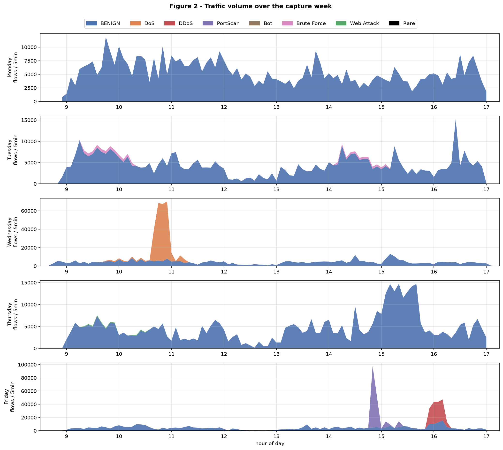
<p class="cap"><b>Fig 10.</b> Traffic volume per 5-minute bin over the capture week, stacked by family. Monday has no attacks; every attack runs in short bursts on one day.</p></div>

<div class="figure">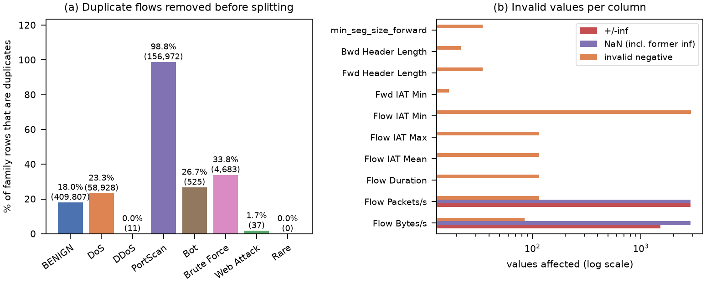
<p class="cap"><b>Fig 11.</b> Data quality: (a) share and number of exact duplicate flows removed per family before the split; (b) infinite, missing and invalid negative values per column.</p></div>

<div class="figure">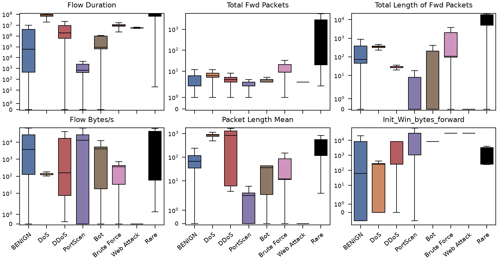
<p class="cap"><b>Fig 12.</b> Six key flow features per family (box plots on a symmetric-log scale, outliers hidden).</p></div>

<div class="figure">
<p class="cap"><b>Fig 13.</b> Clustered Pearson correlation of the candidate features (200,000 sampled flows); each dark block is a group of redundant columns.</p></div>

<div class="figure">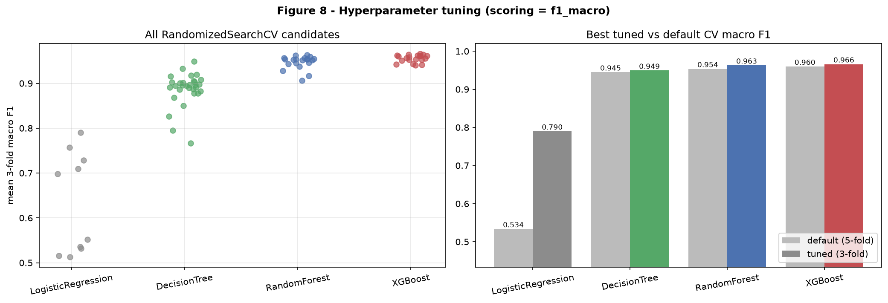
<p class="cap"><b>Fig 14.</b> Hyperparameter tuning: (a) mean 3-fold macro F1 of every RandomizedSearchCV candidate; (b) best tuned score against the default-parameter 5-fold score.</p></div>

<div class="figure">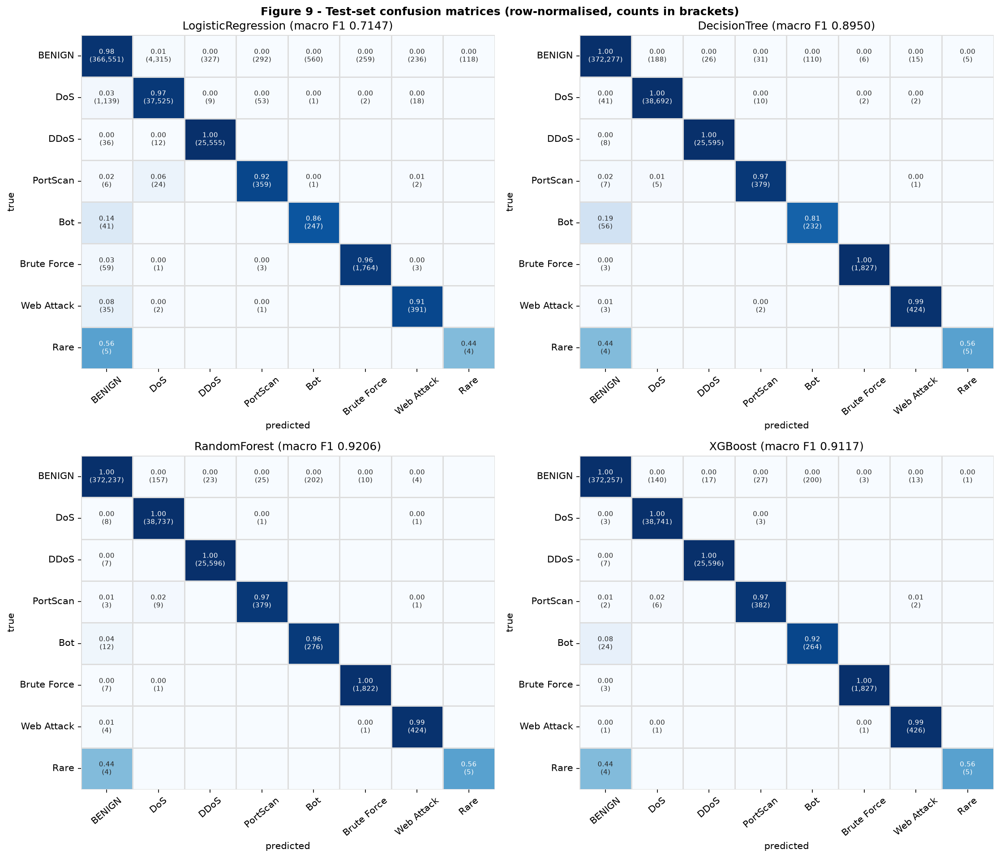
<p class="cap"><b>Fig 15.</b> Test confusion matrices of all four models, normalised by row (recall per true class), with raw counts under each value.</p></div>

<div class="figure">
<p class="cap"><b>Fig 16.</b> Model comparison on the test split: (a) multi-class metrics, (b) derived binary <code>is_malicious</code> metrics and (c) training and inference time (log scale).</p></div>

<div class="figure">
<p class="cap"><b>Fig 17.</b> Test F1 for each class and model, with test support in brackets.</p></div>

<div class="figure">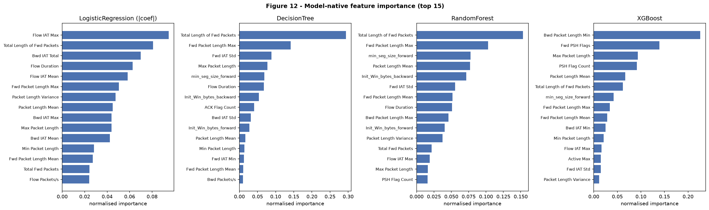
<p class="cap"><b>Fig 18.</b> Top 15 model-native importances per model (impurity for the trees, gain for XGBoost, mean |coefficient| for Logistic Regression).</p></div>

<div class="figure">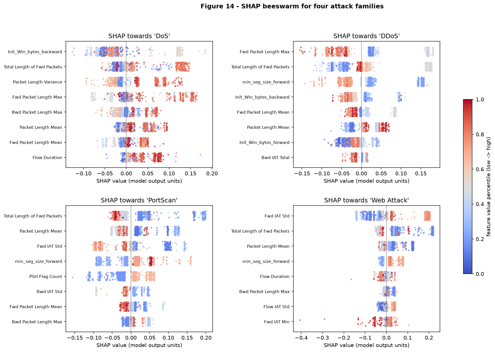
<p class="cap"><b>Fig 19.</b> SHAP beeswarm plots of the final Random Forest for four attack families: each dot is a test flow, its position the push towards the family and its colour the feature value percentile.</p></div>

<div class="figure">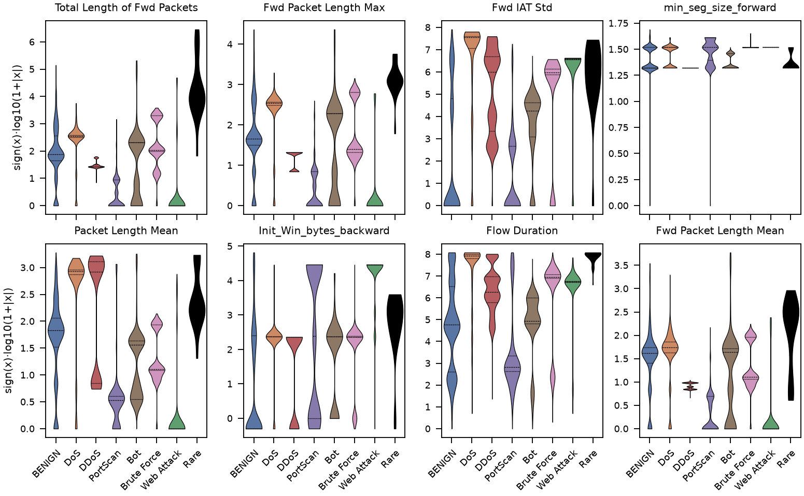
<p class="cap"><b>Fig 20.</b> Distribution of the eight most explanatory SHAP features per family (violin plots on a signed log scale, training split).</p></div>

<div class="figure">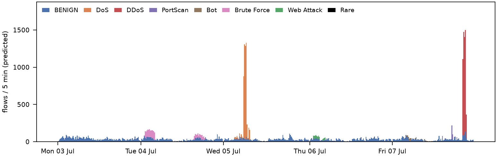
<p class="cap"><b>Fig 21.</b> Replay of the 29,999-flow dataset sample through the final model: predicted families per 5-minute bin over capture time (active periods only).</p></div>
