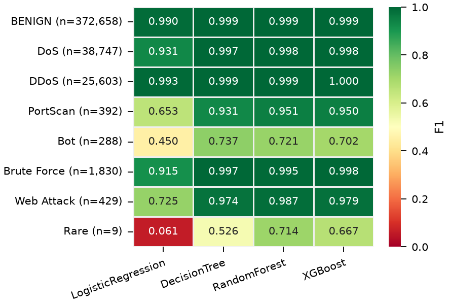

# CyberReplay: Machine Learning-Based Network Intrusion Detection and Attack Analysis

<b>Shreyansh Krishna</b> (2026CS05055) &nbsp;·&nbsp; <b>Aamir Lanker</b> (2026CS05054) &nbsp;·&nbsp; <b>Harshith G. D</b> (2026CS05053) 
Course: Machine Learning 
Track A (library-based ML) · Code, notebook and dashboard: <code>github.com/Shreyansh124/cyberreplay</code>

## 1. Problem and motivation

Fixed-signature intrusion detectors miss altered forms of familiar threats and raise alerts with little context. By
training machine-learning classifiers on flow statistics, we can both spot malicious traffic and identify its attack
category for faster triage. CyberReplay sorts flows into **8 families** (BENIGN, DoS, DDoS, PortScan, Bot, Brute Force,
Web Attack, Rare) and sets a binary `is_malicious` flag whenever the predicted family ≠ BENIGN. We benchmark four Track
A models, attach SHAP attributions to each alert, and replay recorded traffic in a Streamlit app. Heavy class imbalance
makes **macro F1** our main metric.

## 2. Dataset

We use **CIC-IDS2017** [1], captured by the Canadian Institute for Cybersecurity at UNB over five days (3-7 July 2017)
on a 25-host lab network running scripted attacks. CICFlowMeter converts traffic into 2,830,743 bidirectional flows
with 80+ summary variables across 15 labels. This benchmark combines real protocols, heavy skew and timestamps suited
to ordered replay. We load the *GeneratedLabelledFlows / TrafficLabelling* CSVs, which retain Flow ID, IPs, ports and
Timestamp. UNB publishes the dataset at <https://www.unb.ca/cic/datasets/ids-2017.html> but gates downloads behind a
registration form, so our script fetches the byte-for-byte identical archive from a Hugging Face mirror and verifies its
SHA-256 hash; the file is `csvs/GeneratedLabelledFlows.zip` at <https://huggingface.co/datasets/bencorn/CICIDS2017>. The repo ships a stratified 29,999-flow
subset under `data/sample/`. We merge Hulk, GoldenEye, slowloris and Slowhttptest as **DoS**; FTP-/SSH-Patator as
**Brute Force**; Brute Force, XSS and SQL Injection as **Web Attack**; and Infiltration (36 flows) plus Heartbleed (11)
as **Rare**, while leaving DDoS, PortScan and Bot intact.

## 3. Exploratory data analysis - key findings

Figure 1 - flow counts by class on a logarithmic scale · Figure 3 - each attack type appears on only one capture day.

- **Imbalance:** Benign traffic makes up 80.3% of flows, while Rare holds 0.002% and Bot 0.069% (BENIGN:Rare ≈
  48,000:1). Predicting BENIGN everywhere already scores 80% accuracy, so plain accuracy misleads us and we apply class
  weighting.
- **Schedule:** Attacks hit in brief, heavy bursts on one day each (Fig. 3), with DoS Hulk peaking at ~70k flows/5 min.
  Day-based GroupKFold fails because holding out any day drops its attack families from training completely.
- **Data quality:** Zero-duration flows yield 4,376 infinite rates and 1,358 missing values. We also found **630,963
  exact duplicates (22.3%)** and 3,545 invalid negatives; among PortScan rows, 98.8% repeat identical one- or
  two-packet probes.
- **Behaviour:** DoS connections run long (median ≈ 100 s) with heavy forward payloads, whereas DDoS sends tiny uniform
  packets. PortScan and Web Attack mostly omit payload, while Rare connections are both bulky and prolonged. Heavy-tailed
  variables span 6-8 orders of magnitude, and 48.9% of Rare rows exceed the overall 99.9th percentile, showing extreme
  values signal the rarest attacks. Also, 50 column pairs have |r| > 0.95, including 9 identical copies like
  `Subflow Fwd Bytes` = `Total Length of Fwd Packets`.

## 4. Preprocessing and feature engineering

- **Cleaning (deterministic, before the split):** We normalised labels (fixing the cp1252 en dash), mapped them to
  families, replaced ±inf with NaN, and clipped invalid negatives to 0 while keeping the `-1` "no TCP window" flag in
  `Init_Win_bytes_*`. Before splitting, we deduplicated rows on features plus target family, leaving **2,199,780
  flows**, and retained 622 conflicting-label rows.
- **Leakage control:** We created a stratified 80/20 partition with 1,759,824 training and 439,956 test rows, excluding
  Flow ID, IPs, source/destination ports and Timestamp from features. All fitted steps (imputing medians, capping
  outliers, scaling and selecting features) run only on training data within sklearn `Pipeline`s, keeping CV folds
  leak-free.
- **Feature selection (train only):** On training data alone, we dropped 8 constant columns, used a greedy |r| > 0.95
  filter to drop 25 redundant columns, and pruned 7 more beyond 99% cumulative importance of a class-weighted Random
  Forest (**77 → 37 features**).
- **Model-specific preprocessing:** Every model runs column selection and median imputation. Logistic Regression adds
  training-set 99.9th-percentile capping, a signed `log1p` transform and `StandardScaler`, whereas trees use uncapped
  inputs so extreme Rare rows stay separable, and we never drop attack rows as outliers.
- **Imbalance:** We use class weights without SMOTE. Inside `fit`, each estimator converts `class_weighting` into
  sample weights using `balanced` = n/(k·nc) or its square root.

## 5. Models, cross-validation and tuning

We evaluate three tree methods (**Decision Tree** (CART), **Random Forest** and **XGBoost** (hist)) alongside a
multinomial **Logistic Regression** baseline. We run CV and hyperparameter search on a 500k-row *training* subset that
keeps every minority-family row.

| Model | 5-fold CV macro F1 (defaults) | Tuned 3-fold CV macro F1 | Best hyperparameters (RandomizedSearchCV, `f1_macro`) |
|---|---|---|---|
| LogisticRegression | 0.534 ± 0.002 | 0.790 | C = 10.1, square-root class weights (10 candidates) |
| DecisionTree | 0.945 ± 0.018 | 0.949 | entropy, no depth limit, min_samples_leaf 2, max_features 0.8 (30) |
| RandomForest | 0.954 ± 0.012 | 0.963 | 150 trees, max_depth 20, max_features 0.5, entropy (20) |
| XGBoost | 0.960 ± 0.007 | 0.966 | 300 rounds, depth 6, learning rate 0.24, subsample 0.77, colsample 0.68 (20) |

Across folds, tree macro F1 varies by just ±0.007-0.018 and per-fold accuracy never drops below 0.998. Logistic
Regression under fully balanced weights gets 0.95 macro recall but 0.47 macro precision; relaxing the weight strength
raised its macro F1 by +0.26. By contrast, the tree classifiers retain fully balanced weights, and we fit each tuned
pipeline on the **full** training data.

## 6. Results on the held-out test split

| Model | Accuracy | Macro precision | Macro recall | **Macro F1** | 95% CI | Minority recall | BENIGN FPR | Train time | Inference (440k flows) |
|---|---|---|---|---|---|---|---|---|---|
| LogisticRegression | 0.9828 | 0.6497 | 0.8804 | 0.7147 | 0.705-0.726 | 0.819 | 1.64% | 231 s | 0.30 s |
| DecisionTree | 0.9988 | 0.8781 | 0.9140 | 0.8950 | 0.848-0.923 | 0.863 | 0.10% | 32 s | 0.09 s |
| **RandomForest** | 0.9989 | **0.9360** | **0.9329** | **0.9206** | 0.864-0.947 | **0.893** | 0.11% | 92 s | 0.50 s |
| XGBoost | **0.9990** | 0.9111 | 0.9296 | 0.9117 | 0.857-0.943 | 0.888 | 0.11% | 62 s | 1.39 s |

When we derive binary `is_malicious`, tree models reach F1 of 0.996-0.997 (Random Forest: 0.9938 precision, 0.9993
recall) versus 0.947 for Logistic Regression. Paired bootstrap over 300 resamples gives the CIs, with Random Forest
outperforming XGBoost in 99% of draws.

Figure 9 - test confusion matrices normalised by row · Figure 11 - test F1 for each class, with support shown in brackets.

Four classes (BENIGN, DoS, DDoS and Brute Force) are effectively solved at F1 ≥ 0.995, and attacks are rarely confused
with each other. Nearly every error involves BENIGN: Random Forest flags 202 benign flows as Bot plus 157 as DoS, and
misses 12 of 288 Bot flows along with 4 out of 9 Rare rows (each an Infiltration flow). Holdout macro F1 trails CV
(≈0.96) because the real benign share pulls Bot precision down to 0.58 and Rare has just 9 test flows (each miss costs
≈ −0.1 class F1). Excluding Rare lifts the tree models to 0.947-0.950.

**Final model: Random Forest.** We pick Random Forest for its top test macro F1, macro F1 without Rare (0.950), and
minority recall (0.893 across PortScan, Bot, Brute Force, Web Attack and Rare). Its 0.11% BENIGN false-positive rate
produces ≈420 false alarms across 373k benign records, matching XGBoost and cutting Logistic Regression's false alarms
by 15×. Training takes 1.5 min and prediction runs at ~1.1 µs per flow, which is 2.8× faster than XGBoost. XGBoost is a
tight runner-up, while Decision Tree suits tasks needing speed and simple rules. On disk, the saved selection,
imputation and model pipeline occupies roughly 5.5 MB.

## 7. Attack patterns - what distinguishes each attack

Figure 13 - SHAP results from TreeExplainer on 1,759 stratified test flows, expressed as each feature's share of a family's mean |SHAP| toward its own class.

Both tree importances and SHAP highlight forward timing spread (`Fwd IAT Std`), TCP handshake settings
(`min_seg_size_forward`, `Init_Win_bytes_*`) and payload size (`Total Length of Fwd Packets`, `Fwd Packet Length Max`,
`Packet Length Mean`). **DoS:** Connections carry oversized forward packets (median max 343 B vs 44 B benign) and run
long as slow-rate attacks hold sockets open. **DDoS:** Flows send tiny, uniform forward packets totalling 26 B per
flow. **PortScan:** Probes last microseconds, exchange 1-2 packets at steady intervals, and carry no payload. **Web
Attack:** Forward payload is nearly absent, yet forward packet spacing is irregular (`Fwd IAT Std` median 3.8 s vs 0).
**Brute Force:** A constant `min_seg_size_forward` and TCP window expose the attack tool's TCP stack. **Bot:** Flows pair
medium payloads with the C&C server's TCP window. **Rare:** Heartbleed transfers ~12 kB over ~100 s during exfiltration,
while benign median duration is 59 ms.

## 8. Dashboard, traffic replay and explanations (steps 11-14)

We built a Streamlit app around the saved pipeline for batch analysis and live playback. It scores all flows to report
class counts and binary metrics, then **replays** traffic chronologically at 1×-3600× capture speed with configurable
batch sizes while updating KPIs, an alert stream and a detection timeline. Interactive Plotly charts show feature
distributions by attack family, the model benchmark, the confusion matrix and the alert timeline. Selecting an alert
**explains** the prediction with its class, confidence, probabilities, top SHAP contributors and plain-text evidence
such as *"Flagged as Rare with 100% confidence. Main evidence: Total Length of Fwd Packets = 13,712 is much higher than
typical benign traffic (74); Flow Duration = 119 s is much higher than typical benign traffic (58.6 ms)"*. We verified
the app headlessly by replaying the 29,999-flow sample from the test split in `streamlit.testing.v1.AppTest` and
starting `streamlit run --server.headless`.

## 9. Limitations and future scope

- **Optimistic evaluation.** Stratified random splitting puts flows from the same attack burst into both train and test,
  and single-day schedules rule out day-level GroupKFold, meaning our metrics reflect detection of seen attacks on the
  same testbed rather than generalisation to new tools or networks.
- **Label quality.** Audits document labelling and flow-building defects in CIC-IDS2017 [2]. Among the 202 BENIGN→Bot
  "false alarms", 158 contact 205.174.165.73:8080, the same Ares C&C endpoint seen across all labelled Bot flows,
  suggesting unlabelled bot activity; zero-payload PortScan and Web Attack rows partly stem from TCP teardown artefacts.
- **Tiny classes and fingerprints.** Only 47 Rare flows exist (with 9 in test), leaving its F1 uncertain and
  Infiltration recall low (3/7). TCP-stack features also fingerprint capture tools, so they might not transfer cleanly.
- **Offline features.** CICFlowMeter emits features only after flows close, while timestamps resolve only to the minute,
  keeping replay near-real-time.
- **Future work:** We would test per-class probability thresholds or cost-sensitive calibration to trim leftover Bot
  and DoS false alarms, re-evaluate on corrected labels [2] and CSE-CIC-IDS2018, run time-ordered splits inside attack
  days, explore streaming features, and add anomaly detection for zero-day threats.

**Conclusion.** After dropping duplicates and identifiers, our class-weighted Random Forest uses 37 flow features to
separate eight families at 0.921 test macro F1 (0.950 without Rare). It catches 99.9% of malicious traffic with only
0.11% false alarms in roughly a microsecond per flow, while our replay app and SHAP attributions clarify why each alert
fired.

**References.** [1] I. Sharafaldin, A. H. Lashkari, A. A. Ghorbani, "Toward Generating a New Intrusion Detection Dataset and
Intrusion Traffic Characterization", ICISSP 2018, pp. 108-116. [2] G. Engelen, V. Rimmer, W. Joosen, "Troubleshooting an
Intrusion Detection Dataset: the CICIDS2017 Case Study", IEEE S&P Workshops 2021. [3] F. Pedregosa et al., "Scikit-learn:
Machine Learning in Python", JMLR 12, 2011. [4] T. Chen, C. Guestrin, "XGBoost: A Scalable Tree Boosting System", KDD 2016.
[5] S. M. Lundberg, S.-I. Lee, "A Unified Approach to Interpreting Model Predictions", NeurIPS 2017; S. M. Lundberg et al.,
"From local explanations to global understanding with explainable AI for trees", Nature Machine Intelligence 2, 2020.
