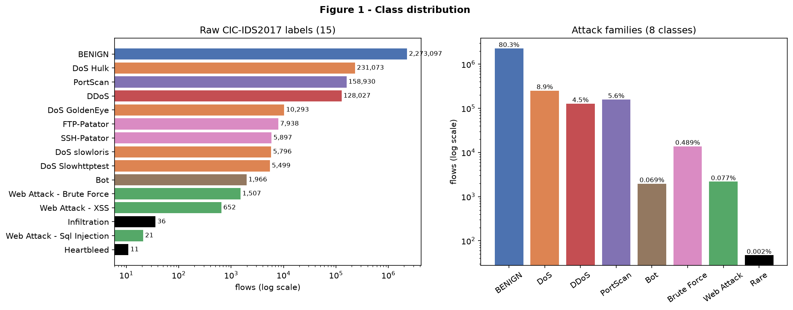

# CyberReplay: Machine Learning-Based Network Intrusion Detection and Attack Analysis

<b>[Student Name]</b> &nbsp;·&nbsp; <b>[Roll Number]</b> &nbsp;·&nbsp; <b>[Course]</b> &nbsp;·&nbsp; <b>[Institute]</b> 
Track A (library-based ML) · Code, notebook and dashboard: <code>github.com/Shreyansh124/cyberreplay</code>

## 1. Problem and motivation

Signature-based intrusion detection systems miss new variants of known attacks and produce alerts without context. A
flow-level machine-learning classifier can tell an analyst not only *that* a connection is malicious but *which kind* of
attack it is, so alerts can be triaged by family. CyberReplay classifies network flows into **8 families** (BENIGN, DoS,
DDoS, PortScan, Bot, Brute Force, Web Attack, Rare), derives a binary `is_malicious` flag from the prediction
(predicted family ≠ BENIGN), compares four Track A models, explains every detection with SHAP and replays the captured
traffic through a Streamlit dashboard. The classes are extremely imbalanced, so the primary metric is **macro F1**.

## 2. Dataset

**CIC-IDS2017** (Canadian Institute for Cybersecurity, UNB) [1]: five days (3-7 July 2017) of traffic from a 25-host
testbed with scripted attacks, converted by CICFlowMeter into bidirectional flows with 80+ statistical features and
15 labels. It is a standard, non-trivial IDS benchmark: 2,830,743 flows, real protocols, strong imbalance and timestamps
that allow a chronological replay. We use the *GeneratedLabelledFlows / TrafficLabelling* CSVs (with Flow ID, IPs, ports,
Timestamp). Source: official page <https://www.unb.ca/cic/datasets/ids-2017.html>; because the official download now sits
behind a registration form, the automated download fetches the byte-identical archive from the Hugging Face mirror
<https://huggingface.co/datasets/bencorn/CICIDS2017> (`csvs/GeneratedLabelledFlows.zip`, SHA-256 verified). A stratified
29,999-flow sample is included in the repository (`data/sample/`). Families: **DoS** = Hulk, GoldenEye, slowloris,
Slowhttptest; **Brute Force** = FTP-/SSH-Patator; **Web Attack** = Brute Force, XSS, SQL Injection; **Rare** =
Infiltration (36 flows) + Heartbleed (11); DDoS, PortScan and Bot are kept as they are.

## 3. Exploratory data analysis - key findings

Figure 1 - class distribution (log scale) · Figure 3 - every attack type occurs on a single capture day.

- **Imbalance:** BENIGN is 80.3% of the flows, Bot 0.069% and Rare 0.002% (BENIGN:Rare ≈ 48,000:1), so accuracy is
  meaningless (constant BENIGN scores 80%) and class weighting is needed.
- **Schedule:** each attack is a short, intense burst on one day (Fig. 3; e.g. DoS Hulk peaks at ~70k flows/5 min). Hence
  GroupKFold by day is infeasible - holding out a day removes its attack classes from training entirely.
- **Data quality:** 4,376 infinite and 1,358 missing rates (zero-duration flows), 3,545 invalid negatives and **630,963
  exact duplicates (22.3%)**; 98.8% of PortScan flows are identical one/two-packet probes.
- **Behaviour:** DoS flows are long (median ≈ 100 s) with large forward payloads, DDoS flows have tiny uniform packets,
  PortScan and Web Attack flows mostly carry no payload, and Rare flows are huge and long. Features are heavy-tailed over
  6-8 orders of magnitude; 48.9% of Rare rows contain a value above the global 99.9th percentile, i.e. for the rarest
  attacks extreme values are the signal. 50 feature pairs have |r| > 0.95 (9 exact copies, e.g. `Subflow Fwd Bytes` =
  `Total Length of Fwd Packets`).

## 4. Preprocessing and feature engineering

- **Cleaning (deterministic, before the split):** labels normalised (cp1252 en dash) and mapped to families; ±inf → NaN;
  impossible negatives clipped to 0 (the `-1` "no TCP window" sentinel of `Init_Win_bytes_*` kept); duplicates over the
  feature columns + family removed **before** splitting (2,199,780 flows remain). 622 rows with conflicting labels are kept.
- **Leakage control:** stratified 80/20 split (1,759,824 train / 439,956 test). Flow ID, IPs, both ports and Timestamp are
  never features. Every fitted step - median imputation, outlier capping, scaling, feature selection - uses training data
  only, and preprocessing lives inside sklearn `Pipeline`s, so CV folds are also leak-free.
- **Feature selection (train only):** variance filter (8 constant columns) → greedy correlation filter |r| > 0.95 (25
  redundant twins) → class-weighted Random Forest importance, 99% cumulative (7 more): **77 → 37 features**.
- **Model-specific preprocessing:** all models get column selection + median imputation; Logistic Regression additionally
  gets capping at the training 99.9th percentile, signed `log1p` and `StandardScaler`. Trees see uncapped values so that
  extreme Rare flows stay separable - no attack row is ever deleted.
- **Imbalance:** class weights only (no SMOTE). Each estimator converts a `class_weighting` hyperparameter
  (`balanced` = n/(k·nc) or its square root) into sample weights inside `fit`.

## 5. Models, cross-validation and tuning

Four models: multinomial **Logistic Regression** (linear baseline), **Decision Tree** (CART), **Random Forest** and
**XGBoost** (hist). CV and tuning use a 500k-row sample of the *training* split that keeps every row of the small families.

| Model | 5-fold CV macro F1 (defaults) | Tuned 3-fold CV macro F1 | Best hyperparameters (RandomizedSearchCV, `f1_macro`) |
|---|---|---|---|
| LogisticRegression | 0.534 ± 0.002 | 0.790 | C = 10.1, square-root class weights (10 candidates) |
| DecisionTree | 0.945 ± 0.018 | 0.949 | entropy, no depth limit, min_samples_leaf 2, max_features 0.8 (30) |
| RandomForest | 0.954 ± 0.012 | 0.963 | 150 trees, max_depth 20, max_features 0.5, entropy (20) |
| XGBoost | 0.960 ± 0.007 | 0.966 | 300 rounds, depth 6, learning rate 0.24, subsample 0.77, colsample 0.68 (20) |

Per-fold scores of the tree models vary by only ±0.007-0.018 (accuracy ≥ 0.998 in every fold); with fully balanced weights
Logistic Regression has macro recall 0.95 but precision 0.47 - tuning the weighting strength lifted it by +0.26. Tree models
keep fully balanced weights. The tuned pipelines were then refitted on the **full** training split.

## 6. Results on the held-out test split

| Model | Accuracy | Macro precision | Macro recall | **Macro F1** | 95% CI | Minority recall | BENIGN FPR | Train time | Inference (440k flows) |
|---|---|---|---|---|---|---|---|---|---|
| LogisticRegression | 0.9828 | 0.6497 | 0.8804 | 0.7147 | 0.705-0.726 | 0.819 | 1.64% | 231 s | 0.30 s |
| DecisionTree | 0.9988 | 0.8781 | 0.9140 | 0.8950 | 0.848-0.923 | 0.863 | 0.10% | 32 s | 0.09 s |
| **RandomForest** | 0.9989 | **0.9360** | **0.9329** | **0.9206** | 0.864-0.947 | **0.893** | 0.11% | 92 s | 0.50 s |
| XGBoost | **0.9990** | 0.9111 | 0.9296 | 0.9117 | 0.857-0.943 | 0.888 | 0.11% | 62 s | 1.39 s |

Binary `is_malicious` (derived): tree models reach F1 0.996-0.997 (Random Forest: precision 0.9938, recall 0.9993);
Logistic Regression 0.947. CIs are paired bootstrap intervals (300 resamples); Random Forest beats XGBoost in 99% of them.

Figure 9 - row-normalised test confusion matrices · Figure 11 - per-class test F1 (support in brackets).

BENIGN, DoS, DDoS and Brute Force are solved (F1 ≥ 0.995). Almost every error involves BENIGN: for Random Forest 202 benign
flows are predicted as Bot and 157 as DoS, while 4 of the 9 Rare flows (all Infiltration) and 12 of 288 Bot flows are missed.
Attack families are almost never confused with each other. Test macro F1 is below CV (≈0.96) because the test split has
the real BENIGN share (Bot precision falls to 0.58) and because Rare has only 9 test flows (one miss ≈ −0.1 F1 on that
class); without Rare the tree models score 0.947-0.950.

**Final model: Random Forest.** It has the best test macro F1 and macro F1 without Rare (0.950), the best minority-class
recall (0.893 over PortScan, Bot, Brute Force, Web Attack, Rare), a 0.11% BENIGN false-positive rate (≈420 false alarms in
373k benign flows, the same as XGBoost and 15× fewer than Logistic Regression), trains in 1.5 min and predicts at
~1.1 µs/flow, 2.8× faster than XGBoost. XGBoost is a very close second; Decision Tree is the choice when speed and
interpretability dominate. The saved pipeline (feature selection + imputation + model) is about 5.5 MB.

## 7. Attack patterns - what distinguishes each attack

Figure 13 - SHAP (TreeExplainer, 1,759 stratified test flows): share of each family's mean |SHAP| towards its own class.

Payload size (`Total Length of Fwd Packets`, `Fwd Packet Length Max`, `Packet Length Mean`), TCP-handshake parameters
(`min_seg_size_forward`, `Init_Win_bytes_*`) and forward timing variability (`Fwd IAT Std`) dominate both the native
importances and SHAP. **DoS:** large forward packets (median 343 B max vs 44 B benign) and very long flows (slow-rate
attacks hold connections open). **DDoS:** tiny, uniform forward packets (26 B per flow). **PortScan:** no payload,
1-2 packets, microsecond durations and regular timing. **Web Attack:** almost no forward payload but irregular forward
timing (high `Fwd IAT Std`, median 3.8 s vs 0). **Brute Force:** a fixed `min_seg_size_forward` / TCP window - the attack
tool's TCP stack. **Bot:** moderate payloads and the C&C server's TCP window. **Rare:** ~12 kB over ~100 s (Heartbleed
exfiltration; benign median flow lasts 59 ms).

## 8. Dashboard, traffic replay and explanations (steps 11-14)

The Streamlit app loads the saved pipeline and (i) predicts every flow and shows attack frequencies and binary metrics;
(ii) **replays** flows in timestamp order with an adjustable speed (1×-3600× capture time) and batch size, updating live
KPIs, a detection timeline and an alert feed; (iii) offers interactive Plotly views of per-attack feature distributions,
the detection timeline, the confusion matrix and the model comparison; and (iv) **explains a selected detection**:
predicted class, confidence, class probabilities, SHAP top features and a plain-language reason such as *"Flagged as Rare
with 100% confidence. Main evidence: Total Length of Fwd Packets = 13,712 is much higher than typical benign traffic (74);
Flow Duration = 119 s is much higher than typical benign traffic (58.6 ms)"*. The app was verified headlessly with
`streamlit.testing.v1.AppTest` (full replay of the 29,999-flow test-split sample) and `streamlit run --server.headless`.

## 9. Limitations and future scope

- **Optimistic evaluation.** The random split places flows of the same attack burst in train and test; GroupKFold by day is
  impossible, so results measure recognition of known attacks in the same network, not transfer to new networks or tools.
- **Label quality.** CIC-IDS2017 has documented labelling and flow-construction errors [2]. 158 of the 202 BENIGN→Bot
  "false alarms" go to 205.174.165.73:8080 - the Ares C&C server used by every labelled Bot flow - and are probably
  unlabelled bot traffic; zero-payload Web Attack/PortScan flows are partly TCP-teardown artefacts.
- **Tiny classes and fingerprints.** Rare has 47 flows (9 in test) - its F1 is very uncertain and Infiltration recall is
  low (3/7). TCP-stack features identify the specific attack tools and may not generalise.
- **Offline features.** CICFlowMeter features exist only when a flow ends and timestamps have minute resolution, so the
  replay is near-real-time.
- **Future work:** per-class probability thresholds / cost-sensitive calibration to remove the remaining Bot/DoS false
  alarms; evaluation on corrected labels [2] and cross-dataset tests (CSE-CIC-IDS2018); time-aware validation within attack
  days; streaming flow features; and an anomaly-detection layer for zero-day attacks.

**Conclusion.** After removing duplicates and identifiers, a class-weighted Random Forest on 37 flow features classifies eight
attack families with test macro F1 0.921 (0.950 without Rare), detects 99.9% of malicious flows at a 0.11% false-alarm rate
and predicts in about a microsecond per flow; SHAP and the replay dashboard make every alert explainable.

**References.** [1] I. Sharafaldin, A. H. Lashkari, A. A. Ghorbani, "Toward Generating a New Intrusion Detection Dataset and
Intrusion Traffic Characterization", ICISSP 2018, pp. 108-116. [2] G. Engelen, V. Rimmer, W. Joosen, "Troubleshooting an
Intrusion Detection Dataset: the CICIDS2017 Case Study", IEEE S&P Workshops 2021. [3] F. Pedregosa et al., "Scikit-learn:
Machine Learning in Python", JMLR 12, 2011. [4] T. Chen, C. Guestrin, "XGBoost: A Scalable Tree Boosting System", KDD 2016.
[5] S. M. Lundberg, S.-I. Lee, "A Unified Approach to Interpreting Model Predictions", NeurIPS 2017; S. M. Lundberg et al.,
"From local explanations to global understanding with explainable AI for trees", Nature Machine Intelligence 2, 2020.
