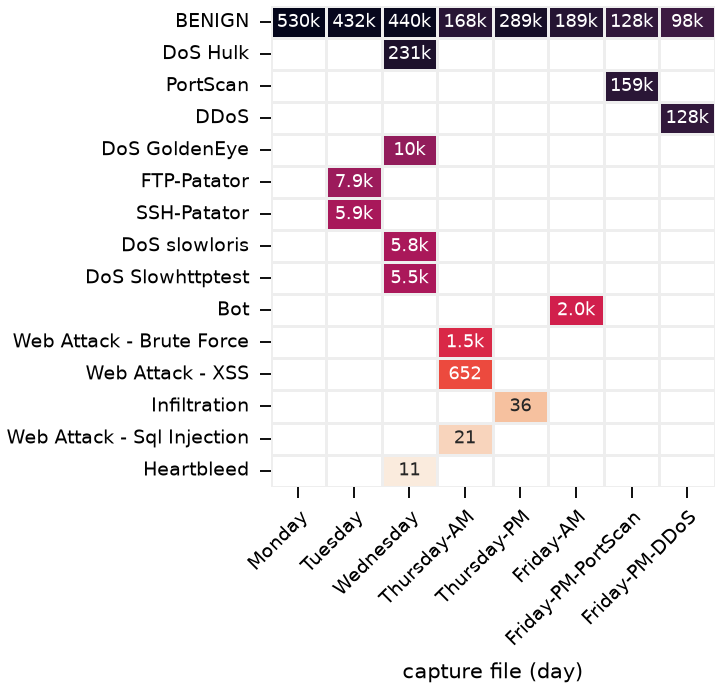
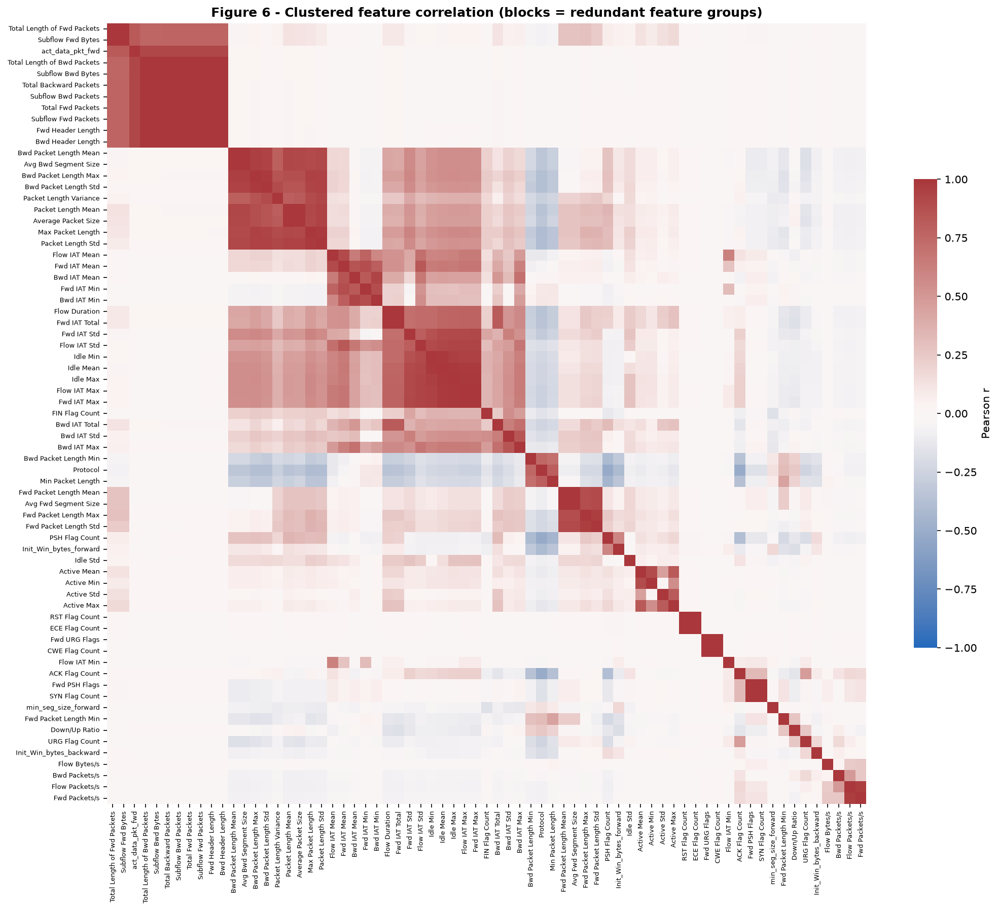
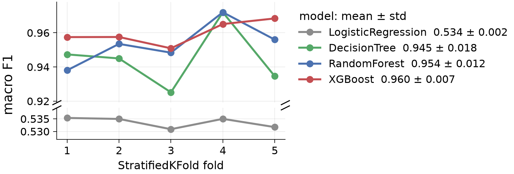
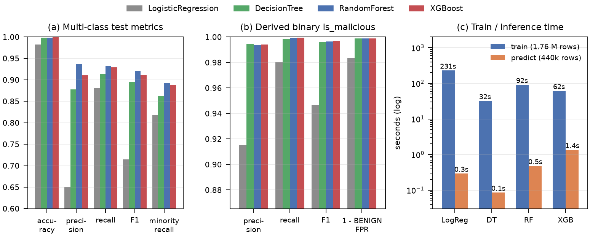

# CyberReplay: Machine Learning-Based Network Intrusion Detection and Attack Analysis

<div class="title-block">
<span style="white-space:nowrap"><b>Shreyansh Krishna</b> (2026CS05055)</span> &nbsp;·&nbsp; <span style="white-space:nowrap"><b>Aamir Lanker</b> (2026CS05054)</span> &nbsp;·&nbsp; <span style="white-space:nowrap"><b>Harshith G. D</b> (2026CS05053)</span> &nbsp;·&nbsp; <span style="white-space:nowrap"><b>Anil Pandey</b> (2026CS05031)</span><br>
Course: Machine Learning · Track A (library-based ML)
</div>

<div style="border:1px solid #888; background:#f4f4f4; padding:4pt 7pt; margin:2pt 0 6pt 0;" markdown="1">
**Summary of results.** We tuned and compared four models on 439,956 held-out test flows. **Random Forest is our final
model.** It has the best macro F1 (0.921, against 0.912 for XGBoost, 0.895 for Decision Tree and 0.715 for Logistic
Regression), the best minority-class recall (0.893), accuracy 0.9989 and a 0.11% BENIGN false-alarm rate, and it
predicts in about 1.1 µs per flow, 2.8× faster than XGBoost. As a malicious-versus-benign detector it reaches F1 0.997
(precision 0.9938, recall 0.9993).
</div>

## 1. Problem and motivation

Fixed-signature intrusion detectors miss altered forms of familiar threats and raise alerts with little context. Classifiers
trained on flow statistics can both spot malicious traffic and name its attack category for faster triage. CyberReplay sorts flows into **8 families** (BENIGN, DoS, DDoS, PortScan, Bot, Brute Force,
Web Attack, Rare) and sets a binary `is_malicious` flag whenever the predicted family ≠ BENIGN. We benchmark four Track
A models, attach SHAP attributions to each alert, and replay recorded traffic in a Streamlit app. Heavy class imbalance
makes **macro F1** our main metric.

## 2. Dataset

We use **CIC-IDS2017** [1], captured by the Canadian Institute for Cybersecurity at UNB over five days (3-7 July 2017)
on a 25-host lab network running scripted attacks. CICFlowMeter [6] converts traffic into 2,830,743 bidirectional flows
with 80+ summary variables across 15 labels. This benchmark combines real protocols, heavy skew and timestamps suited
to ordered replay. We load the *GeneratedLabelledFlows / TrafficLabelling* CSVs, which retain Flow ID, IPs, ports and
Timestamp. UNB publishes the dataset at <https://www.unb.ca/cic/datasets/ids-2017.html> but gates downloads behind a
registration form, so our script fetches the identical `csvs/GeneratedLabelledFlows.zip` from a Hugging Face mirror,
<https://huggingface.co/datasets/bencorn/CICIDS2017>, and verifies its SHA-256 hash. Our project ships a stratified 29,999-flow
subset under `data/sample/`. We merge Hulk, GoldenEye, slowloris and Slowhttptest as **DoS**; FTP-/SSH-Patator as
**Brute Force**; Brute Force, XSS and SQL Injection as **Web Attack**; and Infiltration (36 flows) plus Heartbleed (11)
as **Rare**, while leaving DDoS, PortScan and Bot intact. Five sample flows show the raw label, the family and
binary target we derive from it, and three flow statistics:

<div class="tight" markdown="1">

| Timestamp | Raw `Label` | `family` | `is_malicious` | Flow Duration (µs) | Total Fwd Packets | Total Length of Fwd Packets (B) |
|:---|:---|:---|---:|---:|---:|---:|
| 2017-07-03 08:57:05 | BENIGN | BENIGN | 0 | 149 | 2 | 328 |
| 2017-07-04 14:09:00 | SSH-Patator | Brute Force | 1 | 12,497,639 | 22 | 2,008 |
| 2017-07-05 09:48:00 | DoS slowloris | DoS | 1 | 508,471 | 4 | 231 |
| 2017-07-05 15:14:00 | Heartbleed | Rare | 1 | 119,262,216 | 2,792 | 13,712 |
| 2017-07-07 13:05:00 | PortScan | PortScan | 1 | 52 | 1 | 0 |

</div>

<div style="break-inside:avoid" markdown="1">

## 3. Exploratory data analysis - key findings

<div class="cols"></div>

</div>
<p class="fig">Figure 1 - flow counts by class on a logarithmic scale · Figure 3 - each attack type appears on only one capture day.</p>

- **Imbalance:** Benign traffic makes up 80.3% of flows, while Rare holds 0.002% and Bot 0.069% (BENIGN:Rare ≈
  48,000:1). Predicting BENIGN everywhere already scores 80% accuracy, so plain accuracy misleads us and we apply class
  weighting.
- **Schedule:** Attacks hit in brief, heavy bursts on one day each (Fig. 3), with DoS Hulk peaking at ~70k flows/5 min.
  Day-based GroupKFold fails because holding out any day drops its attack families from training completely.
- **Data quality:** Zero-duration flows yield 4,376 infinite rates and 1,358 missing values. We also found **630,963
  exact duplicates (22.3%)** and 3,545 invalid negatives; among PortScan rows, 98.8% repeat identical one- or
  two-packet probes.
- **Behaviour:** DoS connections run long (median ≈ 100 s) with heavy forward payloads, whereas DDoS sends tiny uniform
  packets (Fig. 5). PortScan and Web Attack mostly omit payload, while Rare connections are both bulky and prolonged.
  Heavy-tailed variables span 6-8 orders of magnitude, and 48.9% of Rare rows exceed the overall 99.9th percentile,
  showing extreme values signal the rarest attacks. Also, 50 column pairs have |r| > 0.95 (the dark blocks in Fig. 6),
  including 9 identical copies like `Subflow Fwd Bytes` = `Total Length of Fwd Packets`.

<div class="cols" style="justify-content:center"></div>
<p class="fig">Figure 5 - six key flow features per family (symlog scale, outliers hidden) · Figure 6 - clustered Pearson correlation of the candidate features; each dark block is a group of redundant columns.</p>

## 4. Preprocessing and feature engineering

- **Cleaning (deterministic, before the split):** We normalised labels (fixing the cp1252 en dash), mapped them to
  families, replaced ±inf with NaN, and clipped invalid negatives to 0 while keeping the `-1` "no TCP window" flag in
  `Init_Win_bytes_*`. Before splitting, we deduplicated rows on features plus target family, leaving **2,199,780
  flows**, and retained 622 conflicting-label rows.
- **Leakage control:** We created a stratified 80/20 partition with 1,759,824 training and 439,956 test rows, excluding
  Flow ID, IPs, source/destination ports and Timestamp from features. All fitted steps (imputing medians, capping
  outliers, scaling and selecting features) run only on training data within scikit-learn [3] `Pipeline`s, keeping CV folds
  leak-free.
- **Feature selection (train only):** On training data alone, we dropped 8 constant columns, used a greedy |r| > 0.95
  filter to drop 25 redundant columns, and pruned 7 more beyond 99% cumulative importance of a class-weighted Random
  Forest (**77 → 37 features**).
- **Model-specific preprocessing:** Every model runs column selection and median imputation. Logistic Regression adds
  training-set 99.9th-percentile capping, a signed `log1p` transform and `StandardScaler`, whereas trees use uncapped
  inputs so extreme Rare rows stay separable, and we never drop attack rows as outliers.
- **Imbalance:** We use class weights without SMOTE. Inside `fit`, each estimator converts `class_weighting` into
  sample weights using `balanced` = n/(k·n<sub>c</sub>) or its square root.

## 5. Models, cross-validation and tuning

We evaluate three tree methods (**Decision Tree** (CART), **Random Forest** [7] and **XGBoost** (hist) [4]) alongside a
multinomial **Logistic Regression** baseline. We run CV and hyperparameter search on a 500k-row *training* subset that
keeps every minority-family row.

| Model | 5-fold CV macro F1 (defaults) | Tuned 3-fold CV macro F1 | Best hyperparameters (RandomizedSearchCV, `f1_macro`) |
|---|---|---|---|
| LogisticRegression | 0.534 ± 0.002 | 0.790 | C = 10.1, square-root class weights (10 candidates) |
| DecisionTree | 0.945 ± 0.018 | 0.949 | entropy, no depth limit, min_samples_leaf 2, max_features 0.8 (30) |
| RandomForest | 0.954 ± 0.012 | 0.963 | 150 trees, max_depth 20, max_features 0.5, entropy (20) |
| XGBoost | 0.960 ± 0.007 | 0.966 | 300 rounds, depth 6, learning rate 0.24, subsample 0.77, colsample 0.68 (20) |

Across folds (Fig. 7), tree macro F1 varies by just ±0.007-0.018 and per-fold accuracy never drops below 0.998. Logistic
Regression under fully balanced weights gets 0.95 macro recall but 0.47 macro precision; relaxing the weight strength
raised its macro F1 by +0.26. By contrast, the tree classifiers retain fully balanced weights, and we fit each tuned
pipeline on the **full** training data.

## 6. Results on the held-out test split

| Model | Accuracy | Macro precision | Macro recall | **Macro F1** | 95% CI | Minority recall | BENIGN FPR | Train time | Inference (440k flows) |
|---|---|---|---|---|---|---|---|---|---|
| LogisticRegression | 0.9828 | 0.6497 | 0.8804 | 0.7147 | 0.705-0.726 | 0.819 | 1.64% | 231 s | 0.30 s |
| DecisionTree | 0.9988 | 0.8781 | 0.9140 | 0.8950 | 0.848-0.923 | 0.863 | 0.10% | 32 s | 0.09 s |
| **RandomForest** | 0.9989 | **0.9360** | **0.9329** | **0.9206** | 0.864-0.947 | **0.893** | 0.11% | 92 s | 0.50 s |
| XGBoost | **0.9990** | 0.9111 | 0.9296 | 0.9117 | 0.857-0.943 | 0.888 | 0.11% | 62 s | 1.39 s |

When we derive binary `is_malicious`, tree models reach F1 of 0.996-0.997 (Random Forest: 0.9938 precision, 0.9993
recall) versus 0.947 for Logistic Regression. Paired bootstrap over 300 resamples gives the CIs, with Random Forest
outperforming XGBoost in 99% of draws. Figure 10 sets these scores side by side with the training and inference times.

<div class="cols" style="justify-content:center"></div>
<p class="fig">Figure 7 - macro F1 per stratified CV fold and fold mean ± std (default hyperparameters) · Figure 10 - test metrics, derived binary metrics and timings.</p>

<div class="cols"></div>
<p class="fig">Figure 9 - test confusion matrices normalised by row · Figure 11 - test F1 for each class, with support shown in brackets.</p>

Four classes (BENIGN, DoS, DDoS and Brute Force) are effectively solved at F1 ≥ 0.995, and attacks are rarely confused
with each other. Nearly every error involves BENIGN: Random Forest flags 202 benign flows as Bot plus 157 as DoS, and
misses 12 of 288 Bot flows along with 4 out of 9 Rare rows (each an Infiltration flow). Holdout macro F1 trails CV
(≈0.96) because the real benign share pulls Bot precision down to 0.58 and Rare has just 9 test flows (each miss costs
≈ −0.1 class F1). Excluding Rare lifts the tree models to 0.947-0.950.

**Recall by original attack label.** To see which tools inside a family the Random Forest misses, we split its test
recall over the 15 raw labels of the same held-out split. All four DoS tools, DDoS, FTP-Patator and Heartbleed reach at least 0.998, so merging the DoS variants into one family hides no weak
tool. The weakest sub-types are Infiltration (3 of 7 detected, the other 4 called BENIGN), Bot (12 of 288 missed as
BENIGN), PortScan (9 of its 13 misses predicted as DoS) and Web Attack - XSS (115 of 118). The 5 SQL Injection flows
are all caught, though so few flows say little.

<div class="tight" markdown="1">

| Raw label | Test flows | Recall | Raw label | Test flows | Recall | Raw label | Test flows | Recall |
|:---|---:|---:|:---|---:|---:|:---|---:|---:|
| BENIGN | 372,658 | 0.9989 | DDoS | 25,603 | 0.9997 | Web Attack - Brute Force | 306 | 0.9935 |
| DoS Hulk | 34,618 | 0.9999 | PortScan | 392 | 0.9668 | Web Attack - XSS | 118 | 0.9746 |
| DoS GoldenEye | 2,066 | 0.9990 | Bot | 288 | 0.9583 | Web Attack - Sql Injection | 5 | 1.0000 |
| DoS slowloris | 1,019 | 0.9990 | FTP-Patator | 1,194 | 0.9983 | Infiltration | 7 | 0.4286 |
| DoS Slowhttptest | 1,044 | 0.9981 | SSH-Patator | 636 | 0.9906 | Heartbleed | 2 | 1.0000 |

</div>
<p class="fig">Random Forest test recall per raw label (flows predicted as the label's family); the full table, with the most common wrong family, is <code>reports/results/per_raw_label_recall.csv</code>.</p>

**Final model: Random Forest.** We pick Random Forest for its top test macro F1, macro F1 without Rare (0.950), and
minority recall (0.893 across PortScan, Bot, Brute Force, Web Attack and Rare). Its 0.11% BENIGN false-positive rate
produces ≈420 false alarms across 373k benign records, matching XGBoost and cutting Logistic Regression's false alarms
by 15×. Training takes 1.5 min and prediction runs at ~1.1 µs per flow, which is 2.8× faster than XGBoost. XGBoost is a
tight runner-up, while Decision Tree suits tasks needing speed and simple rules. On disk, the saved selection,
imputation and model pipeline occupies roughly 5.5 MB.

## 7. Attack patterns - what distinguishes each attack

<div class="cols" style="justify-content:center;align-items:center"></div>
<p class="fig">Figure 12 - top 15 model-native importances per model (impurity for the trees, gain for XGBoost, mean |coefficient| for Logistic Regression) · Figure 13 - SHAP results from TreeExplainer on 1,759 stratified test flows, expressed as each feature's share of a family's mean |SHAP| toward its own class.</p>

Both tree importances (Fig. 12) and SHAP [5] (Fig. 13) highlight forward timing spread (`Fwd IAT Std`), TCP handshake settings
(`min_seg_size_forward`, `Init_Win_bytes_*`) and payload size (`Total Length of Fwd Packets`, `Fwd Packet Length Max`,
`Packet Length Mean`). **DoS:** Connections carry oversized forward packets (median max 343 B vs 44 B benign) and run
long as slow-rate attacks hold sockets open. **DDoS:** Flows send tiny, uniform forward packets totalling 26 B per
flow. **PortScan:** Probes last microseconds, exchange 1-2 packets at steady intervals, and carry no payload. **Web
Attack:** Forward payload is nearly absent, yet forward packet spacing is irregular (`Fwd IAT Std` median 3.8 s vs 0).
**Brute Force:** A constant `min_seg_size_forward` and TCP window expose the attack tool's TCP stack. **Bot:** Flows pair
medium payloads with the C&C server's TCP window. **Rare:** Heartbleed transfers ~12 kB over ~100 s during exfiltration,
while benign median duration is 59 ms.

## 8. Dashboard, traffic replay and explanations (steps 11-14)

We built a Streamlit [8] app around the saved pipeline for batch analysis and live playback. It scores all flows to report
class counts and binary metrics, then **replays** traffic chronologically at 1×-3600× capture speed with configurable
batch sizes while updating KPIs, an alert stream and a detection timeline. Interactive Plotly [9] charts show feature
distributions by attack family, the model benchmark, the confusion matrix and the alert timeline. Selecting an alert
**explains** the prediction with its class, confidence, probabilities, top SHAP contributors and plain-text evidence
such as *"Flagged as Rare with 100% confidence. Main evidence: Total Length of Fwd Packets = 13,712 is much higher than
typical benign traffic (74); Flow Duration = 119 s is much higher than typical benign traffic (58.6 ms)"*. We verified
the app headlessly by replaying the 29,999-flow sample from the test split in `streamlit.testing.v1.AppTest` and
starting `streamlit run --server.headless`.

**Reproducibility and virtual lab.** Every random step (split, samples, CV folds, searches, forests and boosting) uses
seed 42. One command, `PYTHONPATH=src python -m cyberreplay.pipeline --download`, fetches and hash-checks the data and
rebuilds the result tables, Figures 1-16 and the saved model; it reuses the committed tuning results unless `--force` is
given, and our full `--force` run took about 41.5 min on 8 CPUs. The fitted selection, imputation and Random Forest
pipeline is stored as `models/best_model.joblib`, which the notebook and dashboard load directly. Google Colab is our
virtual lab: the notebook's first cell fetches the project code and installs the pinned requirements, so it runs in
Colab with no credentials or local setup.
`requirements.txt` fixes the versions we ran: Python 3.12, scikit-learn 1.9.1 [3], XGBoost 3.4.1 [4], pandas
3.1.1 [10], NumPy 2.5.5 [11], SHAP 0.54.1 [5], Streamlit 1.67.0 [8], Plotly 7.1.0 [9], Matplotlib 3.11.2 [12] and
seaborn 0.13.2 [13].

## 9. Limitations and future scope

- **Optimistic evaluation.** Stratified random splitting puts flows from the same attack burst into both train and test,
  and single-day schedules rule out day-level GroupKFold, meaning our metrics reflect detection of seen attacks on the
  same testbed rather than generalisation to new tools or networks.
- **Label quality.** Audits document labelling and flow-building defects in CIC-IDS2017 [2]. Among the 202 BENIGN→Bot
  "false alarms", 158 contact 205.174.165.73:8080, the same Ares C&C endpoint seen across all labelled Bot flows,
  suggesting unlabelled bot activity; zero-payload PortScan and Web Attack rows partly stem from TCP teardown artefacts.
- **Tiny classes and fingerprints.** Only 47 Rare flows exist (with 9 in test), leaving its F1 uncertain and
  Infiltration recall low (3/7). TCP-stack features also fingerprint capture tools, so they might not transfer cleanly.
- **Offline features.** CICFlowMeter emits features only after flows close, while timestamps resolve only to the minute,
  keeping replay near-real-time.
- **Future work:** We would test per-class probability thresholds or cost-sensitive calibration to trim leftover Bot
  and DoS false alarms, re-evaluate on corrected labels [2] and CSE-CIC-IDS2018, run time-ordered splits inside attack
  days, explore streaming features, and add anomaly detection for zero-day threats.

**Conclusion.** After dropping duplicates and identifiers, our class-weighted Random Forest uses 37 flow features to
separate eight families at 0.921 test macro F1 (0.950 without Rare). It catches 99.9% of malicious traffic with only
0.11% false alarms in roughly a microsecond per flow, while our replay app and SHAP attributions clarify why each alert
fired.

**References.** [1] I. Sharafaldin, A. H. Lashkari, A. A. Ghorbani, "Toward Generating a New Intrusion Detection Dataset and
Intrusion Traffic Characterization", ICISSP 2018, pp. 108-116. [2] G. Engelen, V. Rimmer, W. Joosen, "Troubleshooting an
Intrusion Detection Dataset: the CICIDS2017 Case Study", IEEE S&P Workshops 2021. [3] F. Pedregosa et al., "Scikit-learn:
Machine Learning in Python", JMLR 12, 2011. [4] T. Chen, C. Guestrin, "XGBoost: A Scalable Tree Boosting System", KDD 2016.
[5] S. M. Lundberg, S.-I. Lee, "A Unified Approach to Interpreting Model Predictions", NeurIPS 2017; S. M. Lundberg et al.,
"From local explanations to global understanding with explainable AI for trees", Nature Machine Intelligence 2, 2020.
[6] A. H. Lashkari, G. Draper-Gil, M. S. I. Mamun, A. A. Ghorbani, "Characterization of Tor Traffic using Time based
Features", ICISSP 2017, pp. 253-262 (reference paper for the CICFlowMeter tool). [7] L. Breiman, "Random Forests", Machine Learning
45(1), pp. 5-32, 2001. [8] Streamlit, open-source Python framework for data apps, v1.67.0, <https://streamlit.io>.
[9] Plotly Technologies Inc., "Collaborative data science", Montréal, 2015; Plotly Python library v7.1.0,
<https://plotly.com/python/>. [10] W. McKinney, "Data Structures for Statistical Computing in Python", Proc. 9th Python
in Science Conf. (SciPy 2010), pp. 56-61. [11] C. R. Harris et al., "Array programming with NumPy", Nature 585,
pp. 357-362, 2020. [12] J. D. Hunter, "Matplotlib: A 2D Graphics Environment", Computing in Science & Engineering 9(3),
pp. 90-95, 2007. [13] M. L. Waskom, "seaborn: statistical data visualization", Journal of Open Source Software 6(60),
3021, 2021.

<div style="page-break-before:always"></div>

## Appendix A. Key code, explained

Each excerpt is copied unchanged from `src/cyberreplay/`; the number before each line is its line number in that
file, `...` marks skipped lines and a bracketed path marks a change of file. The bullets after each excerpt say what
the code does and why it is written that way.

### A.1 Cleaning: infinities, negatives and duplicates (`src/cyberreplay/clean.py` lines 159-166, 184-187, 203-212)

```
159      for c in cols:
160          if c in config.SENTINEL_NEGATIVE_COLS:
161              continue
162          mask = df[c].to_numpy() < 0
163          if mask.any():
164              counts[c] = int(mask.sum())
165              df.loc[mask, c] = 0
166      return counts
     ...
184      dup = df.duplicated(subset=cols + [config.TARGET_COL], keep="first")
185      removed = df.loc[dup, config.TARGET_COL].value_counts().to_dict()
186      out = df.loc[~dup].reset_index(drop=True)
187      conflicting = int(out.duplicated(subset=cols, keep=False).sum())
     ...
203      report = CleaningReport(rows_in=len(df))
204      df = add_labels(df)
205      cols = feature_columns(df)
206      report.inf_counts = replace_infinite(df, cols)
207      nan = df[cols].isna().sum()
208      report.nan_counts = {k: int(v) for k, v in nan[nan > 0].items()}
209      report.negative_counts = clip_negatives(df, cols)
210      df, report.duplicates_removed, report.conflicting_rows = drop_duplicates(df, cols)
211      report.rows_out = len(df)
212      return df, report
```

- `clean` applies fixed rules only: labels are normalised and mapped to families, ±inf becomes NaN, invalid
  negatives are clipped and duplicates are removed. None of these steps learns a statistic from the data, which is why
  it is safe to run them on the whole dataset before the split.
- Negative durations, counts and rates are measurement errors, so we set them to 0 and keep the row. The
  `Init_Win_bytes_*` columns are skipped because CICFlowMeter writes −1 there to mean "no TCP window seen".
- A duplicate is the same feature vector with the same family. Removing these before the split means one flow can
  never sit in both train and test; rows whose features recur under another family (622) are counted but kept.
- The NaN values are left in place here and filled later by the median imputer inside each model pipeline, which only
  ever sees training rows.

### A.2 Leakage-safe stratified split (`src/cyberreplay/pipeline.py` lines 294-300; `src/cyberreplay/features.py` lines 67-69)

```
     [src/cyberreplay/pipeline.py]
294      raw = stage_load(data_dir, download)
295      clean_df, report = clean.clean_cached(raw)
296      save_table(report.summary(), "cleaning_summary", floatfmt=".0f")
297      stage_eda(raw, clean_df, report)
298      del raw
299      train, test = features.split_train_test(clean_df)
300      del clean_df

     [src/cyberreplay/features.py]
 67      train, test = train_test_split(df, test_size=test_size, stratify=df[config.TARGET_COL],
 68                                     random_state=seed)
 69      return train.reset_index(drop=True), test.reset_index(drop=True)
```

- The order inside `run` is the leakage guard: cleaning and de-duplication finish before `split_train_test` is called,
  and the unsplit frames are deleted right after, so no later stage can reach test rows by accident.
- `stratify` on the family keeps every class at the same share in both parts, which matters most for Rare (38 training
  and 9 test flows).
- `random_state=seed` (42) makes the 1,759,824 / 439,956 partition repeatable; this is how we rebuilt the exact test
  split for the sub-type analysis in Section 6.

### A.3 Feature selection: variance, correlation, importance (`src/cyberreplay/features.py` lines 188-194, 135-143, 161-168)

```
188      after_var = variance_filter(train[candidates])
189      constant = [c for c in candidates if c not in after_var]
190      sample = stratified_sample(train, sample_size, seed=seed)
191      after_corr, correlated = correlation_filter(sample[after_var])
192      after_imp, importance = importance_filter(sample[after_corr], encode_target(sample[config.TARGET_COL]),
193                                                seed=seed)
194      selected = [c for c in candidates if c in after_imp]
     ...
135      corr = X.corr().abs().fillna(0)
136      kept: list[str] = []
137      dropped = []
138      for col in X.columns:
139          partners = corr.loc[col, kept] if kept else pd.Series(dtype=float)
140          if len(partners) and partners.max() > threshold:
141              dropped.append({"dropped": col, "kept_partner": partners.idxmax(), "abs_r": partners.max()})
142          else:
143              kept.append(col)
     ...
161      rf = RandomForestClassifier(n_estimators=100, class_weight="balanced_subsample", n_jobs=config.N_JOBS,
162                                  random_state=seed, min_samples_leaf=2)
163      rf.fit(X.fillna(X.median()), y)
164      imp = (pd.DataFrame({"feature": X.columns, "importance": rf.feature_importances_})
165             .sort_values("importance", ascending=False).reset_index(drop=True))
166      imp["cumulative"] = imp["importance"].cumsum()
167      n_keep = max(min_features, int((imp["cumulative"] < cumulative).sum()) + 1)
168      imp["selected"] = imp.index < n_keep
```

- All three filters receive the training split (or a sample of it) and never the test split.
- The variance step drops constant columns. The greedy correlation step walks the columns in file order and drops any
  column whose |r| with an already kept column exceeds 0.95, so a basic counter survives and its derived twin goes.
- The importance step fits a class-weighted Random Forest (`balanced_subsample`) on a sample that keeps every minority
  row, then keeps the smallest set of features covering 99% of the total importance (never fewer than 15). Together
  the three steps reduce 77 candidates to 37 features.

### A.4 Model pipelines with class weighting (`src/cyberreplay/models.py` lines 43-48, 164-166, 205-206; `src/cyberreplay/features.py` lines 286-297)

```
     [src/cyberreplay/models.py]
 43      w = compute_sample_weight("balanced", y)
 44      if mode == "sqrt":
 45          w = np.sqrt(w)
 46      elif mode != "balanced":
 47          raise ValueError(f"unknown weighting mode {mode}")
 48      return w / w.mean()
     ...
164      def fit(self, X, y, sample_weight=None):
165          """Fit with class-balancing sample weights (``sample_weight`` is ignored)."""
166          return super().fit(X, y, sample_weight=weights_for(np.asarray(y), self.class_weighting))
     ...
205      scale = name == "LogisticRegression"
206      return Pipeline(make_preprocessor(features, scale=scale) + [("model", make_estimator(name, **params))])

     [src/cyberreplay/features.py]
286      steps: list[tuple[str, object]] = [
287          ("select", ColumnSelector(features)),
288          # Median imputation of the NaN Flow Bytes/s / Flow Packets/s (zero-duration flows).
289          ("impute", SimpleImputer(strategy="median")),
290      ]
291      if scale:
292          steps += [
293              ("clip", QuantileClipper()),
294              ("log", FunctionTransformer(signed_log1p, feature_names_out="one-to-one")),
295              ("scale", StandardScaler()),
296          ]
297      return steps
```

- `weights_for` gives each row the weight n/(k·n<sub>c</sub>) of its class (or the square root in `sqrt` mode) and
  rescales the weights to mean 1, so rare families are not swamped by BENIGN.
- Each model computes these weights inside its own `fit`. During CV and tuning they therefore come from the rows of
  the current training fold only, and the weighting strength can be searched like any other hyperparameter.
- `build_pipeline` puts column selection and median imputation in front of every model and adds capping, the signed
  log and `StandardScaler` for Logistic Regression only. As pipeline steps, their statistics are learned from training
  rows, and the saved pipeline accepts raw CIC-IDS2017 rows with identifiers still attached.

### A.5 Hyperparameter tuning with RandomizedSearchCV (`src/cyberreplay/tuning.py` lines 96-103)

```
 96      X, y = tune_df[features], encode_target(tune_df[config.TARGET_COL])
 97      cv = StratifiedKFold(n_splits=folds, shuffle=True, random_state=config.SEED)
 98      search = RandomizedSearchCV(
 99          build_pipeline(name, features), search_space(name), n_iter=n_iter or N_ITER[name],
100          scoring="f1_macro", cv=cv, random_state=config.SEED, refit=False,
101          n_jobs=_outer_jobs(name), error_score="raise", verbose=0,
102      )
103      search.fit(X, y)
```

- `tune_df` is the 500k-row sample drawn from the training split, so the search never touches test flows.
- Shuffled 3-fold `StratifiedKFold` with `scoring="f1_macro"` ranks candidates by our primary metric, and the fixed
  `random_state` makes both the folds and the sampled candidates repeatable.
- `refit=False` because the winning parameters are refitted later on the full 1.76 M training rows (`fit_final`). The
  forest and XGBoost already use all cores internally, so `_outer_jobs` runs their candidates one at a time.

### A.6 Test-set evaluation and metrics (`src/cyberreplay/evaluate.py` lines 101-119)

```
101      X, y = test[features], encode_target(test[config.TARGET_COL])
102      start = time.perf_counter()
103      y_pred = pipe.predict(X)
104      infer = time.perf_counter() - start
105      labels = list(range(len(config.CLASS_ORDER)))
106      p, r, f, s = precision_recall_fscore_support(y, y_pred, labels=labels, zero_division=0)
107      report = pd.DataFrame({"precision": p, "recall": r, "f1": f, "support": s}, index=config.CLASS_ORDER)
108      yb, pb = (y != 0).astype(int), (y_pred != 0).astype(int)
109      metrics = {
110          "model": name,
111          "accuracy": accuracy_score(y, y_pred),
112          "precision_macro": precision_score(y, y_pred, average="macro", zero_division=0),
113          "recall_macro": recall_score(y, y_pred, average="macro", zero_division=0),
114          "f1_macro": f1_score(y, y_pred, average="macro", zero_division=0),
115          "f1_weighted": f1_score(y, y_pred, average="weighted", zero_division=0),
116          # Rare has only 9 test rows, so one flow moves its F1 by ~0.1; report macro F1 without it too.
117          "f1_macro_excl_rare": float(report.drop(index="Rare")["f1"].mean()),
118          "minority_recall": float(report.loc[MINORITY_CLASSES, "recall"].mean()),
119          "benign_fpr": benign_false_positive_rate(y, y_pred),
```

- This is the only place the test split is scored, once per model and after all fitting is finished. The timer around
  `pipe.predict` gives the inference times in the results table.
- Macro averages weight all eight families equally, so Bot and Rare count as much as BENIGN; `zero_division=0` keeps
  them defined if a model never predicts some class.
- The binary `is_malicious` scores compare predicted and true codes with 0 (BENIGN), so one multi-class model serves
  both tasks. Macro F1 without Rare and minority recall come from the same per-class table.

### A.7 SHAP explanations (`src/cyberreplay/explain.py` lines 94-97, 160-166, 379-386)

```
 94      model = pipe.named_steps["model"]
 95      if isinstance(model, WeightedXGBClassifier):
 96          model = model.model_
 97      return shap.TreeExplainer(model)
     ...
160      out = {}
161      fam = y_family.to_numpy()
162      for code, name in enumerate(config.CLASS_ORDER):
163          rows = fam == name
164          if rows.any():
165              out[name] = np.abs(sv[rows, :, code]).mean(axis=0)
166      return pd.DataFrame(out, index=features)
     ...
379      proba = pipe.predict_proba(row[features])[0]
380      code = int(np.argmax(proba))
381      predicted = config.CLASS_ORDER[code]
382      Xp = transform_features(pipe, row, features)
383      sv = shap_values(explainer, Xp)[0, :, code]
384      raw_vals = row[features].iloc[0].astype(float)
385      contrib = pd.DataFrame({"feature": features, "value": raw_vals.to_numpy(),
386                              "benign_median": benign_medians.reindex(features).to_numpy(), "shap": sv})
```

- `make_explainer` unwraps our XGBoost wrapper so that `TreeExplainer` sees the native booster; scikit-learn trees and
  forests are passed in directly.
- `shap_by_family` averages |SHAP| towards class c over the flows that truly belong to c. This is the quantity shown in
  Figure 13: what pushes each family's flows towards their own label.
- `explain_flow`, used by the dashboard, takes the most probable class of one flow, computes that class's SHAP values
  on the preprocessed row and pairs each top feature's raw value with the benign training median to write the
  plain-language reason.

### A.8 Traffic replay loop (`src/cyberreplay/replay.py` lines 99-111)

```
 99      ts = pd.to_datetime(df[config.TIMESTAMP_COL], errors="coerce") if config.TIMESTAMP_COL in df else None
100      n = len(df)
101      prev_time = None
102      for k, lo in enumerate(range(start, n, batch_size)):
103          batch = df.iloc[lo:lo + batch_size]
104          preds = predict_batch(pipe, batch, features)
105          out = pd.concat([batch, preds], axis=1)
106          cap_time = ts.iloc[min(lo + batch_size, n) - 1] if ts is not None else pd.NaT
107          if speed > 0 and prev_time is not None and pd.notna(cap_time) and pd.notna(prev_time):
108              gap = (cap_time - prev_time).total_seconds() / speed
109              sleep(float(np.clip(gap, 0.0, max_sleep)))
110          prev_time = cap_time
111          yield ReplayStep(index=k, batch=out, capture_time=cap_time, progress=min(lo + batch_size, n) / n)
```

- `replay` is a generator: each step predicts one batch of time-ordered flows and yields it, so the dashboard can
  redraw its KPIs, alert stream and timeline between batches.
- The pause between batches is the capture-time gap divided by the speed factor and is capped at `max_sleep`, so idle
  periods in the capture do not freeze the stream. The `sleep` function is injectable, which lets tests replay at full
  speed.

### A.9 Recall by original attack label (`src/cyberreplay/evaluate.py` lines 231-245)

```
231      predicted = pd.Series(np.asarray(config.CLASS_ORDER, dtype=object)[pipe.predict(test[features])],
232                            index=test.index)
233      rows = []
234      for label, family in config.LABEL_TO_FAMILY.items():
235          mask = test[config.RAW_LABEL_COL] == label
236          if not mask.any():
237              continue
238          wrong = predicted[mask & (predicted != family)].value_counts()
239          detected = int((predicted[mask] == family).sum())
240          rows.append({"raw_label": label, "family": family, "support": int(mask.sum()), "detected": detected,
241                       "recall": detected / int(mask.sum()),
242                       "main_error": f"{wrong.index[0]} ({wrong.iloc[0]})" if len(wrong) else ""})
243      out = pd.DataFrame(rows).set_index("raw_label")
244      save_table(out, "per_raw_label_recall")
245      return out
```

- Predictions are turned back into family names and compared with the family of each raw label, so a DoS slowloris
  flow counts as detected when it is predicted as DoS.
- The most frequent wrong family per label is kept as well; this is how we found that most PortScan misses are called
  DoS while almost every other miss is called BENIGN.

**Full program.** These excerpts cover the core of the method only. The complete code (about 3,500 lines in the
`cyberreplay` package and the dashboard, plus build scripts and tests) is too long to list here. The executed notebook
`reports/notebook.pdf` runs every stage and shows all of its outputs.
